# 02. Package skeleton: `prep`, an `inventory` that counts, `summarize`

## Outcome

`.fabro/workflows/dependabot/` exists and passes every offline gate. A hand-fired run,
which task 10 does, would clone the repository, prepare the workspace, count the open
alerts and Dependabot PRs, and publish
`dep_summary = "<repo>: 3 alerts open, 6 Dependabot PRs open (skeleton run; nothing merged or patched)"`.
The merge loop and the patch path come in later tasks. This task fixes the package's
frame: permissions, models, hooks, environment and the Stage-manifest entry. Later tasks
then only add nodes.

## Why

The `workflow.toml` and the graph header carry most of the deployment invariants: the
breaker floor, `stall_timeout`, the generated manifest and guide blocks, `io-stage`,
`git-guard` and the kill-switch variables. Getting them right once, in a graph small
enough to read in one screen, is cheaper than debugging them in the full graph.

## Change

**Invoke `/fabro-workflow` first.** Read 00 (D7, D10, D14, D17, D20, D24, C9), and
`docs/agents/invariants-graph.md` and `invariants-host.md`.

### 1. `.fabro/workflows/dependabot/workflow.toml`

Build it from `pr-review/workflow.toml` and `arch-review/workflow.toml`. It contains,
in this order:

- `_version = 1`, `[workflow] graph = "workflow.fabro"`.
- `[run.model.fallbacks]`: `"glm-5.3-flash" = ["zai:glm-5.3"]`,
  `"glm-5.3" = ["kimi:kimi-k3"]`, `"gpt-6.1-sol" = ["openai:gpt-6-luna"]` (D14). Copy
  `pr-review`'s comment on why the Refuter's fallback is never GLM.
- `[run.run_branch] enabled = true`, `push = false`, with `backlog`'s comment: only
  `open_pr`, `deliver`, `ci_fix_gate` and `remerge_base` push.
- `[run.integrations.github.permissions]`: `contents = "write"`, `issues = "write"`,
  `pull_requests = "write"`, `vulnerability_alerts = "read"`, `checks = "read"`. Add a
  comment saying each one's user. Use the field names that S1 in task 01 proved.
- `[run.agent.mcps.io]`: identical to `backlog`'s.
- `[run.environment.env]`: the generated manifest and agent-guide markers (empty
  between them; step 4 fills them), then `FABRO_API_TOKEN = "{{ secrets.FABRO_API_TOKEN }}"`,
  `FABRO_API_URL = "{{ vars.FABRO_API_URL }}"` and
  `FABRO_AUTO_MERGE = "{{ vars.FABRO_AUTO_MERGE }}"`. **No `id` key**, and never `${X}`.
- Hooks, copied with their comments from `backlog/workflow.toml`:
  - `io-stage` (`stage_start`, `^agent$`);
  - `git-guard` (`pre_tool_use`, `^shell$`, the exit-0 wrapper);
  - `io-guard` (`pre_tool_use`, `(^|[.])refute$`);
  - `discord-failed` (`run_failed`).

  The three review-merge report hooks and `discord-fallback` come in task 07. The
  summary hook comes in task 08.

No `[run.inputs]`: automation fires send none (ADR 0012 fact), and no stylesheet line
reads `inputs`.

### 2. `.fabro/workflows/dependabot/workflow.fabro`

```dot
digraph Dependabot {
    graph [
        goal="Daily Dependabot run: merge the open Dependabot PRs that validate, patch one open alert group through the shared review and merge phase, and report",
        default_fidelity="truncate",
        stall_timeout="60m",
        loop_restart_signature_limit=20,
        model_stylesheet="
            *                 { model: glm-5.3-flash; }
            .dep-patch        { model: glm-5.3-flash; }
        "
    ]
    …
}
```



Put a `//` comment above each graph attribute, in the style of `arch-review`'s, that
says why it has its value. `stall_timeout` is above every node timeout. The breaker is
20 because the graph has a cycle through command nodes (the merge loop) and will import
a phase.

Nodes in this task:

| Node | Type | Job |
|---|---|---|
| `prep` | command | `mkdir -p /tmp/fabro/dep`. Delete every C1-C7 file. Write `date +%s > /tmp/fabro/run_started`, `echo '[]' > /tmp/fabro/dep/results.json`, and `/tmp/fabro/dep/stopped_at` = `prep`. Write `gh repo view --json nameWithOwner,defaultBranchRef` to `/tmp/fabro/dep/repo.json`, and the default branch to `/tmp/fabro/base_ref`. Then the code-index and agent-guide lines, **verbatim** from `arch-review`'s `prep`. Then the per-repository switch (below). Prints `ready`. No routing schema. |
| `inventory` | command, routing | This task: read the counts only. `gh api …/dependabot/alerts?state=open` → `alert_count`; `gh pr list --author app/dependabot --state open` → `dep_pr_count`. Write `stopped_at = inventory` first and clear it on success. Task 03 replaces the body. |
| `summarize` | command, routing | Builds `dep_summary` from the files that exist (task 08 gives it its final form). Publishes `dep_summary` and `stopped_at`. Always exits 0. |
| `finish` | command | `echo done`. It exists only as the target of the summary hook (task 08). |

Edges:

```
start -> prep
prep -> inventory                 [condition="outcome=succeeded"]
prep -> summarize
inventory -> summarize            [condition="outcome=succeeded"]
inventory -> summarize
summarize -> finish               [condition="outcome=succeeded"]
summarize -> finish
finish -> exit
```

**The per-repository switch, in `prep`.** Copy `pr_handoff`'s block from `backlog`. Read
the `dependabot` row for this repository, not the `pr-review` row:

```
select(.workflow == \"dependabot\" and .target.repo == $r)
```

The result goes to `/tmp/fabro/auto_merge_repo`: `1` when the description has no
`auto_merge` token or has `auto_merge=true`, otherwise `0`. An unreachable API also
writes `0`. Then combine it with `FABRO_AUTO_MERGE` the way `rm_setup` does, and write
`/tmp/fabro/dep/merge_enabled` (`1` or `0`) and `/tmp/fabro/dep/merge_off_reason`
(the same sentences `rm_setup` writes). The merge loop reads these two files. The
shared phase reads `auto_merge_repo` itself.

### 3. The Stage manifest

In `.fabro/workflows/_io/manifest.json`, add `"dependabot": {"stages": {}}` under
`workflows`. Task 06 adds `patch`, and task 07's import brings in the phase's stages.
In `ops/fabro-io-manifest.py`, add `"dependabot"` to `WF_ORDER`. Then run
`python3.11 ops/fabro-io-manifest.py generate` to fill the two blocks in the new
`workflow.toml`.

### 4. The offline gates know the package

- `ops/test-task-gates.sh`: add `DEP="$REPO_ROOT/.fabro/workflows/dependabot/workflow.fabro"`
  beside `ARCH` with the same existence check, and the `git-guard` wrapper case for the
  new `workflow.toml` if that test lists files by name.
- `ops/check-graph-invariants.py` finds the package by itself. Run it, and fix the graph
  (not the checker) until it is clean.

## Acceptance

- `make check-fast` and `./ops/test-task-gates.sh` pass.
- `python3.11 ops/check-graph-invariants.py` reports no finding for `dependabot`.
- `python3.11 ops/fabro-io-manifest.py check` passes. The new `workflow.toml`'s
  generated blocks equal what `generate` writes.
- `grep -n '\${' .fabro/workflows/dependabot/workflow.toml` prints nothing.

## Tests

Add a `dependabot — prep` section to `ops/test-task-gates.sh` that extracts `prep` and
runs it with `gh` and `curl` stubbed:

1. The row's description is empty and `FABRO_AUTO_MERGE=1`: `merge_enabled` is `1`.
2. The description is `auto_merge=false`: `merge_enabled` is `0`, and the reason names
   the repository switch.
3. `curl` fails: `merge_enabled` is `0`.
4. The description is `auto_merge=true` and `FABRO_AUTO_MERGE=0`: `merge_enabled` is
   `0`, and the reason names the host switch.
5. `/tmp/fabro/dep/results.json` is `[]`, and no C1-C7 file is left from a previous
   fixture run.

## Depends on

01 (S1 decides the permission names).
