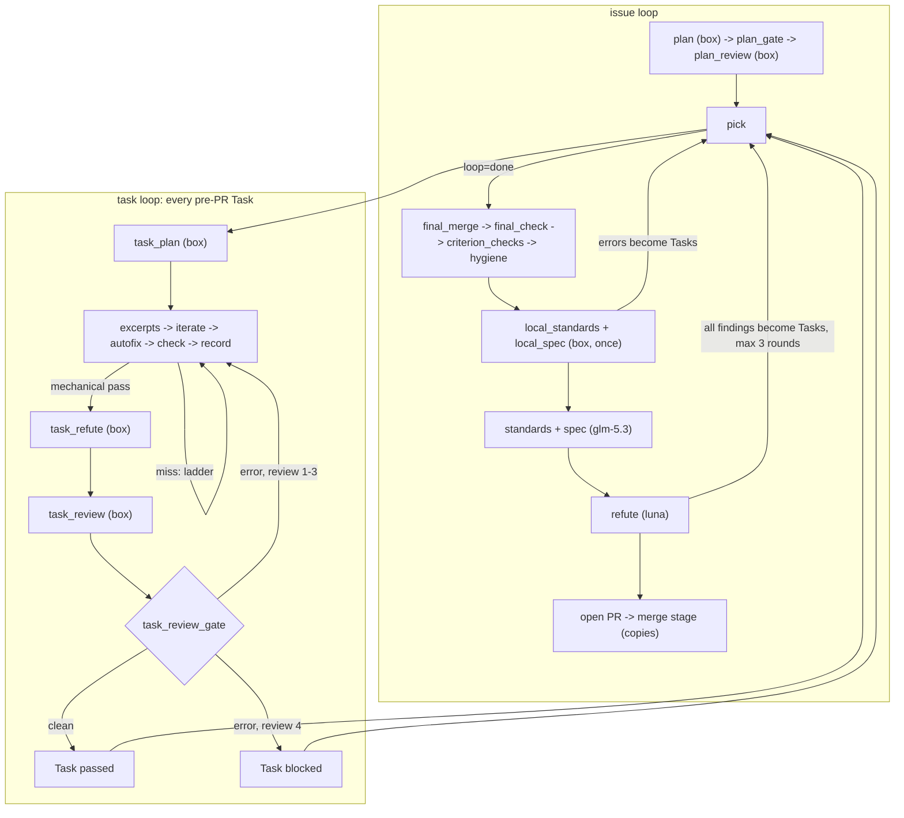

# ralph-v2: overview and canonical contracts

Issue #87, ADR 0034 (proposed). **Planned 2026-11-24. Nothing is built.**

This file is the one place decisions and contracts live. The numbered files are build tasks. Where a
task disagrees with this file, this file wins: fix the task. The folder replaces `docs/ralph-v2/`
(untracked drafts of 2026-11-23), `docs/ralph-v2-glm-design.md` and `.scratch/ralph-v2-superseded/`.
**Do not read those.** Everything still true in them is here.

Read with: `docs/ralph/flow-walkthrough.md`, `docs/agents/invariants-ralph.md`,
`docs/agents/invariants-graph.md`, `CONTEXT.md`.

## Purpose

Better code and more zero-touch merges, with as much inference as possible on the local boxes.

- The box plans, codes and reviews first, at every level. It clears the easy findings.
- Hosted models are fallbacks, final quality checks and cross-family reviewers.
- A drop in throughput is expected and accepted. The experiment measures whether the gain is worth it.

## How to work this series

1. One task, one fresh agent, in the order of the *Build series* table. Read this file and the
   task file whole. Invoke `/fabro-workflow` before any graph work.
2. Work on local `main`. The operator commits this folder before task 01. Start each task with
   `git fetch`; when `origin/main` has moved, `git rebase origin/main`, and stop on a conflict. Commit at the end of each task with the message the task gives, plus the
   attribution lines of the session. **Do not push. Do not deploy. Do not change the host.** Task 13
   is the reviewer's and operator's, and it pushes in three groups.
3. `make check` passes before each commit, with `gawk` first on `PATH` (the Mac's BSD awk fails two
   backlog gate tests). Run the gate tests of a node script you changed in
   `docker run --rm -v "$PWD":/w -w /w python:3.11-slim-bookworm` as well, with `jq gawk git dash`
   installed: the images have jq 1.6 and mawk, and the Mac catches neither.
4. Every decision is made here. If a task cannot be done as written, **stop, change nothing more,
   and report** the file, the line and the conflict. Do not choose an alternative. In particular
   stop if: a quoted script or string no longer exists as quoted, an expected node or edge count
   does not come out, `fabro validate` or a checker rule refuses something this file requires, or a
   test would need a production change this file does not name.
5. Copy `assets/` files verbatim. Never "improve" a prompt, a schema or an ADR text while copying.
6. Report at the end: what was committed (hash), what `make check` printed last, each "Done when"
   line with yes or no, and anything you saw that looks wrong but was out of scope.

## Operator decisions (2026-11-23)

| # | Decision |
|---|---|
| E1 | `ralph-v2` is a parallel package, built complete, with no partial rollout and no shadow period. One hand-fired run on a flakeradar issue comes before the switch and is excluded from the results. |
| E2 | Even issue numbers run `ralph-v2`, odd ones `ralph`. `fast-path` issues still run `backlog`. |
| E3 | Two co-primary measures: zero-touch merges per run, and code quality (*The experiment*). Cost is a guardrail. |
| E4 | Box first at everything. |
| E5 | A per-Task planner on the box, for every pre-PR Task, fix Tasks included. It refreshes the dossier, sets 1-4 goals and lists edge cases. For a fix Task it names the class of the bug. |
| E6 | One Iteration works all open goals of its Task. A goal left over goes to a fresh Iteration. |
| E7 | Every pre-PR Task is reviewed, with no size trigger and no sampling. Exempt: post-PR CI Tasks and the `final_fix` Task. |
| E8 | Task-level review is box only: a refuter session and a combined standards/spec session. Both run every round and both report everything. One rework takes all findings. |
| E9 | An evidenced `error` triggers a rework. Evidenced warnings ride along in that rework. Warnings alone trigger nothing. |
| E10 | A Task gets its first review plus up to 3 box reworks, each re-reviewed on the box. An `error` left after the 4th review blocks the Task, and the PR opens held with the finding in the report. |
| E11 | A rejected review never climbs the coder ladder and never counts as a miss. |
| E12 | The coder may dispute a finding with `path:N` or a command. The next reviewer must withdraw it or cite something new. An unchanged repeat is dropped. |
| E13 | A Task review that returns nothing valid is retried: 3 box tries with a health wait, then 1 on `glm-5.3-flash`. Only if that fails too is a miss recorded and the Task passed. |
| E14 | Issue-level review is hosted: `standards` and `spec` on `glm-5.3`, then `refute` on `gpt-6-luna` last, all in one round with one combined fix. At most 3 rounds, as in v1. The hosted reviews run whatever the box round found. |
| E15 | luna is only the Refuter. No `kimi-k3` anywhere in v2. Models and chains are in *Models*. |
| E16 | Coder ladder, for a failing Task only: box, then `glm-5.3-flash`, then `kimi-for-coding`. |
| E17 | Box stages should rarely or never fall back. A fallback alert is part of this work. |
| E18 | Both arms get `standards`/`spec` on `glm-5.3` and the box planner. Otherwise v1 is frozen until the result. An outage fix goes to both. |
| E19 | The box-plan trial closes as "the box wins" before the switch. |
| E20 | `coders-b` and `coders-d` stay drained. The experiment keeps `local_standards`/`local_spec` in both arms. |

## What changed since 2026-11-23

Three fixes shipped after the decisions were made, and one blocker was found. Each amendment below is
part of the plan; the operator may veto any of them.

| # | Amendment | Why |
|---|---|---|
| A1 | The dispatch payload is cut to one package before anything else (task 01). | The scheduler and the fire scripts upload the whole `.fabro/` tree. It is **1,993,895 of 2,097,152 bytes**, and a second ralph package is about 450,000. The scheduler refuses an oversized tree for **every** workflow, so pushing the new package first would have stopped all dispatch. The server's own automations package only what a graph references (the scout's version id stayed the same over five commits), so they are unaffected. |
| A2 | The hygiene rulings are not in this series. | #92 shipped them to every package on 2026-11-24 (`07fe578`). |
| A3 | E13's 3 box tries: a session that ends with no result is re-run twice by the `stage-end` hooks (#93, `dab47ef`). The check node counts only timeouts and failures, and goes to the fallback when `stage-end` is spent. | Counting both would allow nine sessions for one review. |
| A4 | The whole-branch box lenses get **no** new nodes in either arm. | Their retry exists now: `stage-end` gives three tries for a missing result and `max_retries=1` gives two for a timeout. A hosted fallback would fire on well under 1% of visits (timeouts are 5 and 6 in 92, squared) and adds 4 nodes and 10 edges to the frozen arm. |
| A5 | The box retry policy does not change. | The server's OpenAPI document has no retry or backoff field for a provider or model in 0.362, and the live overlay has none. Every box failover since 2026-11-09 was on 11-13..11-16, with faults minutes apart that no backoff would have covered. C11 (task 02) alerts instead. |
| A6 | Prompts carry a `## Budget` (#94) and the closing sentence that only `submit` counts. | Reviewers that re-weigh findings time out: 12% of `plan_review` visits. |
| A7 | The switch is not before **2026-12-08**, and tasks 03-04 are not pushed before #94's read is posted. | #92's two-week read (held share of `ralph` PRs) ends 2026-12-08, and half of `ralph`'s issues leaving that window makes it unreadable. Task 04 changes the model #94's hosted rows measure. |

## Planning decisions

| # | Decision |
|---|---|
| P1 | Every `ralph-v2` command node that is not new is checked by R10 **against `ralph`'s node**, with recorded replacements. `ralph`'s own rows check it against the shared originals, so one hop is enough, and "an outage fix goes to both" is enforced. Prompts that do not change are R10 rows too. |
| P2 | `record` writes a patch on **every** pre-PR Iteration, passed or missed. A Task whose first Iteration missed has work in both. |
| P3 | A goal names the acceptance statements it covers by 1-based index. The gate checks that the union is complete. |
| P4 | `acceptance[].met = false` with evidence becomes an `error` finding. An uncovered edge case alone becomes a `warning`. The refuter adds its own `defect` error when it can show the case failing. |
| P5 | The refuter and the review are two schemas, two stages, two files, always run in this order. Neither sees the other's result. |
| P6 | `review_prep` checks `loop_exhausted` **before** anything else. v1's order is safe because an exhausted run never reaches it; v2's is not (a >2 MB diff would end a held run at `mark_stuck`). |
| P7 | No `on_failure` attribute anywhere. Agent edges use v1's twin: one `outcome=succeeded`, one unconditional. |
| P8 | `task_plan`, `task_refute`, `task_review` and their twins have `max_retries=0`. Their gate or check node owns the retry. |
| P9 | Rework Iterations do not spend the Iteration cap; E10 bounds them. |
| P10 | `config_changed` is never rulable (already so in #92). |
| P11 | At most 6 edge cases a Task, each tied to an acceptance statement. |
| P12 | Both arms post Learnings to the same `ralph learnings` issue. |
| P13 | The graph is named `RalphV2`, the package `ralph-v2`, the run label `workflow=ralph-v2`. Node ids are bare. |
| P14 | Copied nodes in the new graph carry one comment line, `// copy: ralph.<node>`, not v1's prose. The graph stays under 350,000 bytes. |
| P15 | No manifest struct changes, so no image rebuild and no `min_binary` change. If a task finds otherwise, it stops. |

## Evidence

Method, scripts and numbers: `baseline-queries/`. 133 runs dispatched 2026-11-12..11-23 that reached
the Refuter, read from events on the host, plus the scheduler store.

| Finding | Number | What it did to the design |
|---|---|---|
| Planned Tasks pass on the first Iteration | 386 of 403; fix Tasks 221 of 235; median 3 planned Tasks a run | The planner targets missed edge cases, not failing Tasks (E5). The ladder needs no more rungs |
| Round-1 Refuter blockers are defects | 49 of 65, mostly unhandled inputs | `edge_cases` and the box refuter's register |
| Return trips are expensive | 85 in 133 runs, mean 54 min; 70 involved the Refuter | Find defects per Task |
| Findings arrive one at a time | 64 of 86 failing Refuter visits raised exactly one blocker | Both reviewers run every round and report everything (E8) |
| Fixes are the weak point | 21% of fix Tasks draw a later Refuter blocker against 12% of planned; 36 of 51 later blockers are in a file an earlier round flagged | Fix Tasks are planned and reviewed like any Task; `bug_class` |
| No size threshold | Refuter-hit rate 9% at 4-5 acceptance statements, 16% at 6-8 | No trigger (E7) |
| Whole-branch box lenses show no clear downstream effect | Refute Tasks a run 0.74 before 11-12, 0.76 after; the Refuter fails 41% where the lenses found errors, 36% where clean | The risk this experiment tests |
| Box failover is an incident, not a rate | All on 11-13..11-16 | Keep fallbacks, alert on them (C11) |
| luna is cheap and fast | $0.0054 and 1.1 min p50 a visit | E14 |
| The two parities already differ | 2026-11-12..11-24, `ralph` on both: even 43 of 91 merged, odd 51 of 93. 8 points, about 1 standard error | Read v2's merge result with this A/A check (task 14) |

`docs/ralph-v2`'s "plan_review 0 of 102" and "8.6% of lens visits end with no result" are not used:
both came from counting only runs that reached the Refuter (#93, #94).

**Baseline**, 2026-11-17 on: 108 runs, 55 merged by the run (0.51 a run). Lease time was 4.17
lease-h a run and 8.64 a merge over the first 89 of them. The comparison is against **concurrent** v1.

**The main risk**: two earlier box reviews in this factory showed no clear downstream benefit, and
v2 lets a box review fail a Task. E10, E12 and the evidence rule are the protection; the stop rules
are the backstop.

## Cost model

Measured box times, clean days: an Iteration p50 17.4 min (mean 25 planned, 31 fix), a whole-branch
lens pair p50 17.5, `plan_review` p50 10. 4.25 pre-PR Tasks a run.

| Component | Estimate a run |
|---|---|
| Per-Task plan, 4.25 x ~8 min | ~34 min |
| First review, 4.25 x ~19 min | ~80 min |
| Half a rework round a Task: Iteration ~22 + check 3 + review 19 | ~90 min |
| Issue-level return trips avoided | up to -34 min |
| **Net** | **about +2.8 to +3.4 h; about 7 lease-h a run against 4.17** |

z.ai: `standards` ~173 and `spec` ~57 credits a visit off-peak on `glm-5.3`, 1.64 visits a run, both
arms: about 40,000 of 140,000 a week, up from 18,500. Peak-hour work costs double.

## The shape



## Models

Three separate mechanisms. A review that **rejects** the work triggers none of them.

| Mechanism | Triggered by | Where | Effect |
|---|---|---|---|
| Provider fallback | the model's server errors, after fabro's own retries | `[run.model.fallbacks]` | the same session continues on another model |
| Coder ladder | the Task failed: red `check`, timeout, no valid result, `progress` | `pick`, from `misses` | the next fresh Iteration uses the next rung |
| Review retry | a reviewer left no valid result | `stage-end`, then the `*_check` nodes | the reviewer runs again, then flash |

Stylesheet of `ralph-v2`, exactly:

```
*                 { model: coders-a; }
.plan             { model: {{ inputs.coder_pool | default('coders-a') }}; reasoning_effort: medium; }
.plan-review      { model: {{ inputs.coder_pool | default('coders-a') }}; reasoning_effort: medium; }
.task-plan        { model: {{ inputs.coder_pool | default('coders-a') }}; reasoning_effort: medium; }
.coder            { model: {{ inputs.coder_pool | default('coders-a') }}; reasoning_effort: medium; }
.coder-t2         { model: glm-5.3-flash; }
.coder-t3         { model: kimi-for-coding; }
.task-refute      { model: {{ inputs.coder_pool | default('coders-a') }}; reasoning_effort: medium; }
.task-review      { model: {{ inputs.coder_pool | default('coders-a') }}; reasoning_effort: medium; }
.review-fallback  { model: glm-5.3-flash; }
.review-local     { model: {{ inputs.coder_pool | default('coders-a') }}; reasoning_effort: medium; }
.review-standards { model: glm-5.3; }
.review-spec      { model: glm-5.3; }
.refute           { model: gpt-6-luna; }
.merge-resolve    { model: {{ inputs.coder_pool | default('coders-a') }}; reasoning_effort: medium; }
.learn            { model: {{ inputs.coder_pool | default('coders-a') }}; reasoning_effort: medium; }
```

`ralph-v2` fallbacks, exactly:

```toml
[run.model.fallbacks]
"coders-a" = ["zai:glm-5.3-flash", "kimi:kimi-for-coding"]
"coders-b" = ["zai:glm-5.3-flash", "kimi:kimi-for-coding"]
"coders-c" = ["zai:glm-5.3-flash", "kimi:kimi-for-coding"]
"coders-d" = ["zai:glm-5.3-flash", "kimi:kimi-for-coding"]
"gpt-6-luna" = ["zai:glm-5.3-flash", "orfallback:qwen3.8-27b"]
"glm-5.3-flash" = ["kimi:kimi-for-coding"]
kimi-for-coding = ["zai:glm-5.3"]
"glm-5.3" = ["orfallback:hy4-preview", "openai:gpt-6.1-terra"]
```

`ralph` (v1) changes only its `glm-5.3` row (to the one above) and loses its `kimi-k3` row (task 04).
`hy4-preview` was in the live `fabro model list` on 2026-11-24 (`orfallback`). The plan first named
`gpt-5.6-terra`, the built-in `openai` catalog's terra, which this OpenAI project cannot use; the
pre-push review (2026-11-26) corrected it to `gpt-6.1-terra`, defined in the overlay like
`gpt-6-luna` and passing `fabro model test`.

## Graph

`RalphV2`, **68 nodes and 176 edges**: v1's 59/155, minus `iterate_t4` (1 node, 4 edges), plus the
ten task-loop nodes. The one warning is v1's, `issue_number` unbound in `claim`; never bind it.

| After task | Nodes | Edges |
|---|---|---|
| 05 | 58 | 151 |
| 07 | 60 | 156 |
| 08 | 68 | 175 |
| 09 | 68 | 176 |

`stall_timeout="60m"`, `loop_restart_signature_limit=100`, `default_fidelity="truncate"`, and
`max_node_visits` unset, all as in v1.

### New nodes

| Node | Attributes | What it does |
|---|---|---|
| `task_plan` | `class="task-plan", timeout="30m", max_retries=0, prompt="@prompts/task_plan.md.j2"` | Writes the plan (C2) |
| `task_plan_gate` | command, `timeout="1m"`, routing | C2 |
| `task_review_prep` | command, `timeout="2m"`, routing | C3 |
| `task_refute` | `class="task-refute", timeout="30m", max_retries=0, prompt="@prompts/task_refute.md.j2"` | C5 |
| `task_refute_check` | command, `timeout="15m"`, routing | C4 |
| `task_refute_fb` | `class="review-fallback", timeout="25m", max_retries=0`, same prompt as `task_refute` | C4 |
| `task_review` | `class="task-review", timeout="40m", max_retries=0, prompt="@prompts/task_review.md.j2"` | C5 |
| `task_review_check` | command, `timeout="15m"`, routing | C4 |
| `task_review_fb` | `class="review-fallback", timeout="25m", max_retries=0`, same prompt as `task_review` | C4 |
| `task_review_gate` | command, `timeout="2m"`, routing | C5 |

`resolve_merge` is on the box in v2 (`class="merge-resolve"`, `timeout="60m"`, `max_retries=1`).
`iterate_t1`..`t3` keep v1's timeouts (120m, 60m, 60m). Every other copied node keeps v1's attributes.
All six agent timeouts above are reasoned, not measured: task 13 re-times them.

"Routing" means `shape=parallelogram, output_schema="routing"`; the script prints its routing object
last, publishes **every key on every path**, and exits 0 on every path.

### Edges

The task loop:

```
pick -> task_plan                [condition="context.loop=work && context.rebase_failed=false && context.task_step=plan"]
pick -> excerpts                 [condition="context.loop=work && context.rebase_failed=false && context.task_step=work"]
pick -> task_review_prep         [condition="context.loop=review && context.rebase_failed=false"]
task_plan -> task_plan_gate      [condition="outcome=succeeded"]
task_plan -> task_plan_gate
task_plan_gate -> task_plan      [condition="outcome=succeeded && context.task_plan_route=retry"]
task_plan_gate -> excerpts
record -> task_review_prep       [condition="outcome=succeeded && context.review_due=true"]
record -> pick
task_review_prep -> task_refute  [condition="outcome=succeeded && context.task_review_go=true"]
task_review_prep -> pick
task_refute -> task_refute_check [condition="outcome=succeeded"]
task_refute -> task_refute_check
task_refute_check -> task_refute [condition="outcome=succeeded && context.task_refute_next=retry"]
task_refute_check -> task_refute_fb [condition="outcome=succeeded && context.task_refute_next=fallback"]
task_refute_check -> task_review
task_refute_fb -> task_refute_check [condition="outcome=succeeded"]
task_refute_fb -> task_refute_check
task_review -> task_review_check [condition="outcome=succeeded"]
task_review -> task_review_check
task_review_check -> task_review [condition="outcome=succeeded && context.task_review_next=retry"]
task_review_check -> task_review_fb [condition="outcome=succeeded && context.task_review_next=fallback"]
task_review_check -> task_review_gate
task_review_fb -> task_review_check [condition="outcome=succeeded"]
task_review_fb -> task_review_check
task_review_gate -> pick
```

The other `pick` edges are v1's. `excerpts` has edges for `rung` 1-3 and to `stop_reason`.

The issue-level round (E14). These replace v1's edges between the same nodes:

```
local_review_prep -> review_prep               (unconditional; was refute_prep)
local_review_gate -> review_prep               (unconditional; was refute_prep)
review_prep -> standards                       [condition="outcome=succeeded && context.review_run_standards=true"]
review_prep -> spec                            [condition="outcome=succeeded && context.review_run_standards=false && context.review_run_spec=true"]
review_prep -> refute_prep                     [condition="outcome=succeeded && context.review_run_standards=false && context.review_run_spec=false"]
review_prep -> stop_reason
standards -> spec                              [condition="outcome=succeeded && context.review_run_spec=true"]
standards -> refute_prep                       [condition="outcome=succeeded && context.review_run_spec=false"]
standards -> stop_reason
spec -> refute_prep                            [condition="outcome=succeeded"]
spec -> stop_reason
refute_prep -> refute                          [condition="outcome=succeeded && context.refute_skip=false"]
refute_prep -> review_gate                     [condition="outcome=succeeded && context.refute_skip=true"]
refute_prep -> stop_reason
refute -> refute_gate                          [condition="outcome=succeeded"]
refute -> refute_gate
refute_gate -> review_gate                     [condition="context.refute_route=tasks"]
refute_gate -> review_gate                     [condition="context.refute_route=pass"]
refute_gate -> review_gate                     [condition="context.refute_route=hold && context.loop_exhausted=false"]
refute_gate -> open_pr                         [condition="context.refute_route=hold && context.loop_exhausted=true"]
refute_gate -> stop_reason
```

`review_gate -> pick | open_pr | stop_reason` is v1's.

## Files in `/tmp/fabro`

| Path | Writer | Life |
|---|---|---|
| `task_plan.json` | `task_plan` (submit) | deleted by `pick` |
| `task_plan_error.txt` | `task_plan_gate` | deleted by `pick` and on a valid plan |
| `task_plan_tries` | `task_plan_gate` | deleted by `pick` |
| `task_plans/<id>.json` | `task_plan_gate`, `record` | the run |
| `task_review/in/` | `task_review_prep` | rebuilt each round |
| `task_review/out/refute.json`, `out/review.json` | the reviewers (submit) | deleted by `task_review_prep`, and by a check before a retry |
| `task_review/state/refute.*`, `review.*` (`tries`, `fb`, `served`) | the check nodes | deleted by `task_review_prep` |
| `task_review/state/patches/<id>/<NNN>.patch`, `.../reviewed` | `record`, `task_review_gate` | the run |
| `task_review/state/answers/<id>.json` | `record` | deleted by `task_review_gate` after it is read |
| `task_review/state/findings/<id>.json` | `task_review_gate` | replaced each round, deleted on pass |
| `task_review/state/dropped/<id>.json` | `task_review_gate` | the run |
| `task_review/state/recovers/<id>` | `pick` | deleted by `task_review_gate` |
| `task_review/state/rounds/<id>-<n>.json` | `task_review_gate` | the run (for `fabro dump`) |
| `rework_iterations` | `prep` (0), `record` | the run |

`prep` creates `task_plans/`, `task_review/in/`, `task_review/out/` and `task_review/state/` with its
subdirectories, writes `0` to `rework_iterations`, and removes anything left in them.

## Contracts

### C1. Task states (`tasks.json`)

Statuses: `open`, `reviewing`, `passed`, `blocked`. New fields: `reviews` (0-4, absent reads 0),
`plan_type` (`planned` or `fallback`), `block_reason`, `review_note`.

Writers are command nodes only: v1's list plus `task_review_prep` and `task_review_gate`.

**`pick`**, in this order. Everything not named is v1's script.

1. Delete `task_plan.json`, `task_plan_error.txt` and `task_plan_tries` with v1's per-Iteration files.
2. Phase, mainline merge and `REBASE` as v1. On `REBASE`: `LOOP=work`, `STEP=none`, `RUNG=0`.
3. Otherwise, in phase `pre`, find the first Task with status `reviewing`. If there is one: add 1 to
   `state/recovers/<id>`. At 3 or less, `LOOP=review`, `STEP=none`, `RUNG=0`, write `current_task.json`
   from it, and go to step 6. Above 3, set the Task `passed` with
   `review_note` = `the Task review did not finish`, and go on.
   (`recovers` counts only failures: a normal round never returns to `pick` as `reviewing`.)
4. v1's scan for the first `open` Task, with the cap read from `iterations` (pre) or
   `post_iterations` (post), and these ladder numbers: `RUNG = 1 + misses / 2`; `misses >= 6` sets the
   Task `blocked` with `block_reason` = `6 failed Iterations`. **The cap test is skipped when the
   Task's `reviews` is above 0**: otherwise a Task whose last allowed Iteration passed could never get
   the rework its review asked for (P9).
5. For the picked Task: `STEP=plan` when the phase is `pre`, its `source` is neither `ci` nor
   `final_fix`, and `task_plans/<id>.json` does not exist. Otherwise `STEP=work`. Write
   `current_task.json`, `task_base_sha` and `rung` as v1. Write `task-context.md`: with a stored plan,
   by the C2 render; without one, v1's text.
6. Print `loop`, `rung`, `phase`, `rebase_failed`, `loop_exhausted` and `task_step` (`plan`, `work`
   or `none`) on every path. With `LOOP=review`, do not touch `task_base_sha`.

**`record`**. Everything not named is v1's script.

1. Pass or miss is decided exactly as v1. `PRE` = phase is `pre` and the Task's `source` is neither
   `ci` nor `final_fix`.
2. When `PRE`: write `git diff --no-renames "$(cat task_base_sha)" HEAD` to
   `state/patches/<id>/<NNN>.patch`, `NNN` = the number of patches there plus 1, three digits. An
   empty diff writes no file. A failed diff writes no file and one stderr line.
3. A pass when `PRE` sets `status` to `reviewing`; any other pass sets `passed`. A miss is v1's.
4. Iteration counting: phase `post` adds to `post_iterations` as v1; phase `pre` adds to `iterations`
   when the Task's `reviews` is 0, else to `rework_iterations`. `N` in the progress line is the
   counter it added to. The result word is `passed`, `awaiting review` or `not passed`.
5. With a valid receipt and `PRE`: copy `goals_done` (if an array) into `task_plans/<id>.json` as
   `goals_done` (the union with what is there). When the Task's `reviews` is above 0, write
   `state/answers/<id>.json` as `{"<finding id>": {"answer": "fixed"} |
   {"answer": "disputed", "reason": ..., "evidence": ...}}` from `fixed` and `disputes`, merged over
   what is there. An id in both is `disputed`. A dispute whose `evidence` fails the evidence rule (C5)
   is not written.
6. Print `iteration_passed` (v1's meaning: the mechanical pass) and `review_due` (`true` exactly when
   it set `reviewing`) on every path.

### C2. The Task plan

Schema `assets/schemas/task_plan.schema.json`, output `/tmp/fabro/task_plan.json`.

`task_plan_gate`:

1. Valid when the receipt matches (`_io.stage` is `task_plan`, `_io.visit` equals `.io/stage.json`'s)
   and all of these hold. `error.txt` gets the first that fails, as one sentence:
   - `context` is at most 14,000 bytes;
   - `goals` has 1 to 4 entries with unique ids, and the union of `covers` is exactly `1..n`, where
     `n` is the Task's acceptance count (no index above `n`);
   - each `edge_cases[].covers` is at most `n`, ids unique, at most 6;
   - each goal's `check` holds a backticked span or a `path:N` whose path exists;
   - every `path:N` or `path:N-M` in `context` names a file in the checkout with at least that many
     lines (the pattern is `excerpts`' own: `[A-Za-z0-9_./-]+:[0-9]+(-[0-9]+)?`);
   - `bug_class` is not empty when the Task's `source` is `refute`, `review` or `local_review`.
2. Valid: write `task_plans/<id>.json` = the plan without `_io`, plus `goals_done: []` and
   `plan_type: "planned"`; set the Task's `plan_type`; render `task-context.md`; delete
   `task_plan_error.txt`; route `go`.
3. Invalid, first time (`task_plan_tries` absent): write `1` to it, delete `task_plan.json`, write the
   reason to `task_plan_error.txt`, route `retry`.
4. Invalid, second time: write the fallback plan. `context` = the Task's `context`; one goal per
   acceptance statement, the 4th holding every remaining one (`goal` = the statements joined by `; `,
   `covers` = their indexes, `check` = `(none: fallback plan)`, `files` = the Task's); `edge_cases` and
   `risks` empty; `bug_class` empty; `plan_type: "fallback"`. Then as step 2 from "set".
5. Publish `task_plan_route` (`retry` or `go`), `task_plan_type` (`planned`, `fallback` or `none`),
   `task_plan_goals` and `task_plan_edges` (numbers) on every path. **Never `rung`.** On a failure of
   its own it writes the fallback plan; the unconditional edge to `excerpts` covers a crash.

**The render** (`task-context.md`), used by `pick` and `task_plan_gate`. The jq program is the same
text in both nodes, and a gate test compares them:

```
<context>

## Goals

- g1: <goal> Covers: 1, 2. Check: <check>          (goals not in goals_done)
- g2 (done): <goal>                                (goals in goals_done)

## Edge cases to cover                              (only when there are any)

- e1 (acceptance 1): <case> -> <expected>

## Class of the bug                                 (only when not empty)

<bug_class>
```

`pick` then appends v1's `## Last attempt` (misses above 0 and `feedback/rework.md` present), and,
when `state/findings/<id>.json` exists:

```
## Review findings

Two reviewers found these after attempt <reviews>. Answer every id in `fixed` or `disputes`.

### <id>: <severity>, <kind>, <file>[:<line>]

<message>

Evidence: <evidence>
Class: <class>                                      (only when not empty)
```

### C3. Review inputs

`task_review_prep` (always exits 0):

1. `current_task.json` names the Task. Delete `in/*`, `out/*`, and `state/refute.*` and
   `state/review.*`.
2. `in/task.patch` = every file of `state/patches/<id>/` in order, concatenated. From the second
   review on, `in/delta.patch` = those numbered above the number in `state/patches/<id>/reviewed`.
3. No patch, or `task.patch` over 2,000,000 bytes: set the Task `passed` with `review_note` =
   `no diff to review` or `the diff is too large to review`, publish `task_review_go=false`, stop.
4. `in/task.json` = the Task's `title`, `body`, `acceptance` and `source` only.
   `in/plan.json` = `goals` (id, goal, covers, check), `edge_cases`, `bug_class`, `risks` from the
   stored plan. `in/check.json` = `{"passed": true, "mode": <task_check.json mode or "full">,
   "targets": <[.targets[].name] of task_check.json, or []>}`.
5. From the second review on, `in/history.md`: for each entry of `state/findings/<id>.json`,
   `- <id> (<severity>, <kind>, <source>) <file>[:<line>]: <message>` and a second line: `  Coder: fixed`,
   `  Coder: **disputed**: <reason> Evidence: <evidence>` or `  Coder: no answer`. `<source>` is
   `refuter` or `review`.
6. Publish `task_review_go` on every path.

Sealed lists (manifest). `RULINGS` is `/tmp/fabro/review/hygiene_rulings.json`.

| Stage | Sealed |
|---|---|
| `task_plan` | `/tmp/fabro/task_review/`, `/tmp/fabro/task_plans/`, `/tmp/fabro/tasks.json`, `/tmp/fabro/task_list.json`, `/tmp/fabro/feedback/`, `/tmp/fabro/plan_review/`, `/tmp/fabro/local_review/`, `/tmp/fabro/review/` |
| `task_refute`, `task_refute_fb` | `/tmp/fabro/task_review/state/`, `/tmp/fabro/task_review/out/review.json`, `/tmp/fabro/task_plans/`, `/tmp/fabro/task_plan.json`, `/tmp/fabro/tasks.json`, `/tmp/fabro/current_task.json`, `/tmp/fabro/task-context.md`, `/tmp/fabro/task-code.md`, `/tmp/fabro/progress.md`, `/tmp/fabro/iteration.json`, `/tmp/fabro/task_list.json`, `/tmp/fabro/feedback/`, `/tmp/fabro/plan_review/`, `/tmp/fabro/local_review/`, `/tmp/fabro/review/` |
| `task_review`, `task_review_fb` | the same, with `out/refute.json` instead of `out/review.json` |
| `iterate_t1..t3` | v1's, plus `/tmp/fabro/task_review/`, `/tmp/fabro/task_plans/` |
| `resolve_merge`, `resolve_base`, `learn` | v1's, plus `/tmp/fabro/task_review/`, `/tmp/fabro/task_plans/` |
| `standards`, `spec`, `local_standards`, `local_spec` | v1's, plus `/tmp/fabro/task_review/`, `/tmp/fabro/task_plans/`, `/tmp/fabro/task_plan.json` |
| `refute` | v1's, plus those three, plus `/tmp/fabro/review/standards.json` and `/tmp/fabro/review/spec.json` (fresh when it runs in v2) |
| `plan`, `plan_review` | v1's |

`/tmp/fabro/review/` covers `RULINGS`. The `io-guard` matcher in `ralph-v2` is v1's without
`iterate_t4`, plus `task_plan|task_refute|task_refute_fb|task_review|task_review_fb`.

Inputs (manifest). Every path is under `/tmp/fabro`.

| Stage | Inputs (R = required) |
|---|---|
| `task_plan` | `current_task.json` R, `task-context.md` R, `issue.json` R, `progress.md`, `error.txt` (`task_plan_error.txt`) |
| `task_refute`, `_fb`, `task_review`, `_fb` | `task.json` R, `plan.json` R, `task.patch` R, `check.json` R, `delta.patch`, `history.md` (all in `task_review/in/`) |
| `iterate_t1..t3` | v1's |

Output paths: `task_refute` and `task_refute_fb` both write `task_review/out/refute.json`;
`task_review` and `task_review_fb` both write `task_review/out/review.json`. `box` is `true` for
`task_plan`, `task_refute`, `task_review` and `resolve_merge`, and `false` for the two `_fb` stages.

### C4. The check nodes

`task_refute_check` and `task_review_check` are one program with three names changed
(`task_refute`/`task_review`, `refute`/`review`, `task_refute_next`/`task_review_next`). A gate test
compares them. Let `K` be `refute` or `review`, `NODE` the stage, `OUT` its output.

| State | Action | Publishes |
|---|---|---|
| `OUT` parses, `_io.stage` is `NODE` or `NODE_fb`, `_io.visit` is not empty and equals `.io/stage.json`'s | write `box` or `fallback` to `state/K.served` | `next=done` |
| invalid, and `state/K.fb` exists | write `missed` to `state/K.served`, delete `OUT` | `next=done` |
| invalid, `.io/stage.json`'s node is `NODE` and `.io/stage-end/NODE.succeeded` holds its visit (`stage-end` has spent its two re-runs) | create `state/K.fb`, delete `OUT` | `next=fallback` |
| invalid otherwise | add 1 to `state/K.tries`, delete `OUT`. At 3: create `state/K.fb` | `next=fallback` at 3 |
| below 3 | wait for the box (below). Not healthy in 10 min: create `state/K.fb` | `next=retry`, or `fallback` |

The wait: the pool is `/tmp/fabro/box`; its URL is the matching pair in `FABRO_BOX_HEALTH`
(`pool=url,pool=url`). No pool, no URL or no `curl`: do not wait. Otherwise poll
`curl -s -o /dev/null -m 5 -w '%{http_code}'` every 15 s until `200`, for at most 600 s.

Both publish `<NODE>_next` (`done`, `retry`, `fallback`) and `<NODE>_tries` on every path. Never read
`prompt.completed.provider`: after a failover it still names the box.

### C5. Task review results and `task_review_gate`

Schemas `assets/schemas/task_refute.schema.json` and `task_review.schema.json`.

**The evidence rule** (also used by `record` for disputes): the text holds a `path:N`
(`[A-Za-z0-9_./-]+:[0-9]+`) whose path is a file in the checkout, or a non-empty span in backticks.

`task_review_gate` trusts `state/K.served` (`box` or `fallback` is a result; `missed`, or no file
because the check node crashed, is none, and is published as `missed`): by
then `.io/stage.json` belongs to the second reviewer. Let `n` = the Task's `reviews` + 1.

1. **Candidates.** The refuter's `findings` (source `f`), the review's `findings` (source `s`), one
   `error` finding of kind `spec` per `acceptance` entry with `met=false` whose `evidence` passes the
   rule (message = `Acceptance <i> is not met: <statement>`, file = the path of the evidence's `path:N`,
   or empty), and one `warning` of kind `defect` per `edge_cases` entry with `covered=false` (message =
   `No test covers edge case <id>: <case>`, file empty). An `acceptance` index outside the list is ignored.
2. **Evidence.** Drop a finding from either `findings` list whose `file` is not a file in the checkout
   or whose `evidence` fails the rule. Synthesized findings skip this test.
3. **Disputes.** For each entry of `state/findings/<id>.json` that `state/answers/<id>.json` marks
   `disputed`: look in the result of its own source for a `responses` entry with its id.
   - `upheld`, with `new_evidence` that passes the rule and whose normalized text differs from the
     finding's `evidence`: keep the finding, with `new_evidence` as its evidence.
   - Anything else (`withdrawn`, no entry, no result from that reviewer): add
     `{file, evidence_norm, message}` to `state/dropped/<id>.json`, and drop it.
   Normalized = lower case, whitespace runs to one space, trimmed.
4. **Repeats.** Drop a candidate whose `file` and normalized `evidence` equal an entry of
   `state/dropped/<id>.json` that was there **before** this round or was added in step 3.
5. **Ids.** Survivors (upheld disputes first, then refuter, then review, in order) get
   `<task id>v<n>f<k>` or `<task id>v<n>s<k>`, `k` from 1 per source. Keep `repeat_of`.
6. **Verdict.** `blocking` = survivors with severity `error`. Both reviewers missed: `missed`.
   No blocking: `pass`. Blocking and `n < 4`: `rework`. Blocking and `n = 4`: `blocked`.
7. **State.** `reviews = n`. `pass` and `missed`: status `passed`, delete `state/findings/<id>.json`.
   `rework`: status `open`, write every survivor (errors and warnings) to `state/findings/<id>.json`.
   `blocked`: status `blocked`, `block_reason` = `box review: ` and the first error's message cut at 200
   characters, and write the findings file too. `missed`: `review_note` = `no valid Task review`.
8. Write the patch count to `state/patches/<id>/reviewed`; delete `state/answers/<id>.json` and
   `state/recovers/<id>`; copy both results, the survivors and the drops to `state/rounds/<id>-<n>.json`;
   append to `progress.md`: `## Review <n> of <id>: <verdict>`, a blank line, and `- <message>` per
   error, each cut at 300 characters.
9. Publish on **every** path: `task_review_task`, `task_review_source` (the Task's `source`),
   `task_review_round` (`n`), `task_review_verdict`, `task_review_errors`, `task_review_warnings`,
   `task_review_disputed`, `task_review_withdrawn`, `task_review_dropped`, `task_review_refute_served`,
   `task_review_review_served` (`box`, `fallback`, `missed`), `task_review_edges`,
   `task_review_edges_covered`. A crash publishes nothing and leaves the Task `reviewing`; the
   unconditional edge reaches `pick`, which recovers it (C1 step 3). No edge reads these keys.

A message that could hold a brace never goes to stdout or stderr (fabro scans both for objects).

### C6. `iteration_v2`

Schema `assets/schemas/iteration_v2.schema.json`: v1's `iteration` plus optional `goals_done`,
`edge_tests`, `fixed`, `disputes`. `done` still means the whole Task. `task_block_gate` is unchanged.
v1's `iteration` schema is frozen. The prompt is v1's plus `assets/iterate-replacements.py`.

### C7. Issue-level round

- `review_prep` (R10 replacement): first, when `/tmp/fabro/loop_exhausted` is not empty, delete
  `fix_result.json`, print `review_run_standards=false` and `review_run_spec=false`, and exit 0 (P6).
  The rest is v1's, so its "both false means run both" repair still applies only to the extra pass.
- `refute_prep`, `refute`, `review_gate`: v1's scripts unchanged. `review_gate` reads the route from
  `refute_route`, so the new order needs no edit. Only the edges change.
- `refute_gate` (R10 replacement): the `reason` in `exhausted_result` becomes
  `("not passed when the loop ran out" + (if (.block_reason // "") == "" then "" else ": " + .block_reason end))`.
  The prefix stays: `prfacts.py` and the hold buckets read it.
- `open_pr` (R10 replacement): the *Unmet criteria* line gains the same `: <block_reason>` suffix.

### C8. Scheduler routing

`SCHEDULER_RALPH_V2_SHARE`: `0` (the default and the kill switch), `50` or `100`. `choose_workflow`
gains a third argument. After today's rules answer `ralph`: at 0, `ralph`; at 50, an even number is
`ralph-v2`; at 100, `ralph-v2`. When today's rules answer `backlog`, the answer stays `backlog`.
A requeue keeps its arm, because its number does not change.

### C9. The version payload

`package_paths(entrypoint)` keeps a file when its path starts with `workflows/<package>/` (the
entrypoint's second component) or `workflows/_shared/`. Nothing else in `.fabro/` is read by a run:
no graph references another package's files (checked: the only `import=` targets are `../_shared/`,
and no prompt reference leaves its package), and `_io/` is embedded in each `workflow.toml`.

## The experiment

**Arms**: concurrent, by issue parity, stratified by repository and coder pool. Hand fires and runs
fabro never started are excluded.

**Co-primary measures**, per run:

1. *Merge*: the PR was merged by the run with no operator commit (`merged_by_workflow` and
   `operator_commits = 0`). Every run counts, also one with no PR.
2. *Quality*: blocking findings in the **first** issue-level hosted round: Refuter `not_met` criteria
   + defects + `tampering` rulings, plus `standards` and `spec` errors, all from the submitted results
   of each stage's first completed visit. Counted only for runs where all three stages submitted.
   Exhausted runs reach no hosted reviewer, so report their share per arm beside the measure.

**Guardrail**: lease-hours per merge (measure 1's numerator).

**Read alongside**: operator-commit rate, Refute visits a run, hold reasons, blocked-by-review Tasks,
disputes and withdrawals, review misses and fallbacks, box minutes by new stage, edge cases planned and
covered, z.ai credits, Tasks a run.

**Duration**: four weeks from the switch, or 150 finished runs an arm if that is later.

**Stop early** (checked weekly): v2's lease-hours per merge above 2x v1's after 40 v2 runs; or v2's
merge measure 15 points below v1's after 60 v2 runs; or review misses above 10% of Task reviews in any
week (then the measurement is invalid: fix first, restart the window).

**Result.** A measure is *better* when the difference is above 2 standard errors:
merge `sqrt(p1(1-p1)/n1 + p2(1-p2)/n2)`, quality `sqrt(s1^2/n1 + s2^2/n2)`. v2 wins when one primary
measure is better, the other is not worse by the same test, and lease-hours per merge is within +50%.
v1 stays when neither is better or one is worse. One better and one worse, or a win outside +50%, goes to
the operator. At 180 runs an arm the merge measure's standard error is about 5 points, so a gain under
10 points will not be clear from merges alone.

## Build series

| # | Task | Push group (13) | Deploy | Depends on |
|---|---|---|---|---|
| 01 | Dispatch payload: one package plus `_shared/` | A | scheduler, scripts | none |
| 02 | Ops limits, C11, settings example | A | scheduler, scripts | none |
| 03 | Close the box-plan trial | B | none (live on push) | none |
| 04 | v1: hosted reviews on `glm-5.3` | B | none (live on push) | 03 |
| 05 | `ralph-v2` package skeleton | C | none | 01, 03, 04 |
| 06 | Schemas, prompts, manifest | C | none | 05 |
| 07 | Task plan, `pick`, `record` | C | none | 06 |
| 08 | Task review loop | C | none | 07 |
| 09 | Issue-level order | C | none | 08 |
| 10 | Scheduler routing | C | scheduler | 05 |
| 11 | Measurement | C | scheduler | 08, 10 |
| 12 | Invariants, docs, ADR 0034 | C | none | 09-11 |
| 13 | Reviewer and operator: review, push, shakedown, switch | - | all | 01-12 |
| 14 | Operator: weekly checks and the result | - | none | 13 |

Group A may be pushed as soon as it is reviewed. Group B waits for #94's read. Group C needs group A
**deployed**, or every dispatch stops (A1).

Out of scope, not filed here: CI Iterations (p50 45 min, p90 at the 120 m cap), undraining the second
slots, dropping the whole-branch box lenses. Task 14 lists them as follow-ups.
