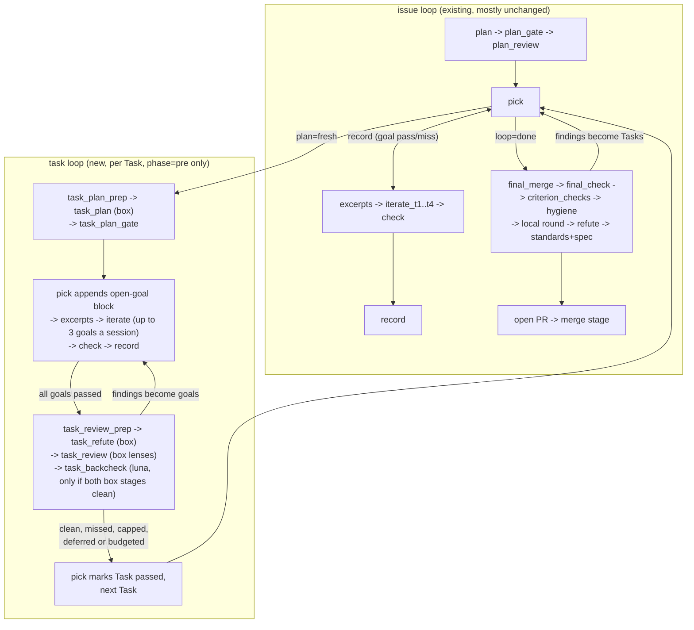
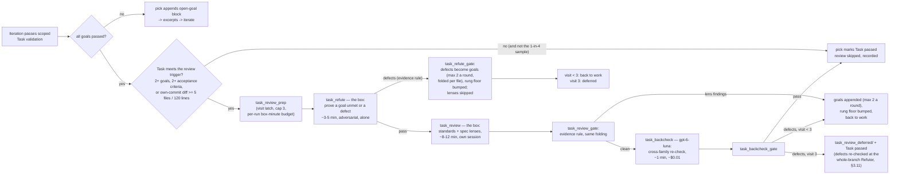

# ralph v2 — per-task goal loops (design)

Design record for issue #87 (Part B), grounded in the prior-art research posted there, this
deployment's measured resources, and three hostile review rounds (graph invariants,
cost/operations, design-vs-evidence; findings folded in — see §14).

Status: draft for review, revision 2. Baseline: `Ralph` at 59 nodes / 155 edges, `main` as
of 2026-11-16.

## 0. Goals and non-goals

**Goals** (from #87 Part B):

1. A per-task plan: each Task is split into goals with acceptance per goal, on the box.
2. A per-task review: a refuter and lenses on the Task's own diff, whose findings become
   goals in the Task's own plan — not new entries in the issue's Task list.
3. A per-task bound: a Task cannot consume the whole run's budget.
4. The issue loop stays: `final_check`, `hygiene`, the local round, the hosted Refuter and
   both reviews are unchanged. Per-task review is a supplement; fewer defects should reach
   them, and they remain the only cross-family check on the whole branch.

**Non-goals**: no change to the merge stage (R10 copies), no change to `backlog`, no
`thread_id`/`fidelity="full"` (F.3), no per-task goals in `tasks.json` (F.4), no parallel
fan-out (Kevin-32B: serial refinement dominates parallel sampling at fixed budget).

**Design principle P0 — the box is first at everything.** Whatever the loop does — work,
refute, review — happens first on the run's leased local model; hosted models appear only
to backcheck locally-clean work. In v2's new stages: the coder is the box at rung 1
(unchanged), the per-task refuter and the per-task lenses are separate cheap box sessions
(refute first), and the single hosted touch per Task is a `gpt-6-luna` backcheck that runs
**only** when both box sessions came back clean — a timed-out or faulted box session sends
the Task on without hosted tokens. The whole-branch local round already obeys the same
order, so v2 makes the tier consistent. Hosted spend happens only on Tasks the box blessed
— the cascade is also a spend gate. One stated exception, for measurement only: a capped
sampled blind audit (§3.10) spends hosted tokens on faulted diffs so the censoring problem
(§9.4) stays solvable; it gates nothing and has its own off knob.

## 1. The resource envelope this designs against

| Resource | State (deploy log, 2026-11-16) | Consequence for v2 |
|---|---|---|
| Fleet slots | **2 undrained coder pools** (coders-a, coders-c; one slot per box leased), ~48 slot-h/day; current era ≈ 16 ralph runs/day × ~2.5–3h lease ≈ **90% utilization** | the binding constraint. v2's per-run add must be budget-capped (§7) or issues/day falls materially (§7, F-fleet) |
| The run's box | leased strix slot, `qwen3.8-flash-next`, 512k ctx, 33–45 tok/s decode | every new stage is a box stage; wall time is decode-dominated, so session costs scale with output, not diff size |
| z.ai GLM plan | 140k credits/week, hit once; `glm-5.3` 6.9 in / 1.7 cached / 24 out per 1M; `flash` exactly 1/3 | v2 adds no z.ai stage; the rung-floor escalation (§3.10) can spend hosted rework rungs — measured, not assumed away (§9) |
| Kimi | `kimi-k3` (standards/spec), monthly cap, exhausted once | v2 adds no kimi load |
| OpenAI | `gpt-6-luna` $0.10 in / $0.01 cached / $0.50 out per 1M; Refuter p50 1.0 min (deploy-log-implied ~$0.01/visit) | the hosted backcheck: ≈ $0.01 × 3–4/run ≈ **$10–20/mo** at ~16 runs/day — against ~$34/mo headroom, stated not waved away |
| orfallback | OpenRouter, fixed $100 budget | luna's fallback row is `orfallback:qwen3.8-27b` (the real `.refute` row) — same-family-as-box on fallback, a named weakness (§5) |
| Background lane | fills a leased box only while every leased sibling loop is mid-hosted-stage and `/health` quiet ≥30s; 117 of 138 fills were during the peak-hours pause | v2 stretches runs and moves minutes onto the box → fewer, and the new ~1-min luna stages open **no** usable gaps; displacement is budgeted (§9.8) |
| Sharpening lease | one at a time, dispatched ahead of issue runs; `unverifiable` (the top hold cause, 31/53) is exactly what it fixes | v2 lengthens runs and so slows the queue that fixes what v2 cannot; mitigations in §8 |
| Hosted guardrail | ~$100/mo, measured ~$66 | v2's hosted add: ~$10–20/mo luna (above) plus bounded escalation rungs (§9.9) |

Measured costs the design builds on: `iterate_t1` p50 **19.8 min** / p90 39.6 (617 visits,
flow-walkthrough); the median run works **4–5 Tasks**; `local_standards` p50 9.8 / p90 27.2
(7 timeouts at 60m), `local_spec` p50 5.2; hosted `standards` 7.1 / `spec` 3.1; `refute`
(luna) 1.0; ~8% of Task-validation visits go red; 31 of the trial's 53 held PRs failed the
Refuter on `unverifiable` criteria only.

## 2. The shape

Two nested loops. The issue loop is ralph v1's, untouched except where noted. The task loop
lives between Task selection and Task completion.



The task loop's cascade — local first at every level, hosted only to backcheck, cheapest
discriminator first, each level able to short-circuit the next:



Every level may only help, and hosted tokens flow only upward through clean local verdicts:
mechanical validation (existing `check`) always runs; the box refuter runs only when
validation passed and the trigger fired; the box lenses run only when the box refuter
passed; the luna backcheck runs only when both box sessions are clean **and receipted** —
a diff the box faulted or timed out on gets reworked or deferred, never re-hosted. A defect
found at level *n* costs one rework Iteration (bounded: at most two per Task, §3.4); the
same defect at the whole-branch round today costs a Final validation + Refuter visit + both
reviews, and after round 3 it holds the PR.

**Goal batching.** Goals are the plan, review and acceptance unit — not the session unit.
One Iteration works up to **3 goals** in one session (the receipt lists `goals: [ids]`);
the Iteration count per run stays near v1's instead of multiplying by the goal count, which
the cost review showed is the difference between +1h and +3h per run. Termination-lag
evidence points the same way: sessions are most effective early, so spend one early session
on the task's adjacent goals rather than three sessions each paying dossier re-read,
`setup.sh` and scoped-check overhead.

## 3. Node-by-node

Ten new nodes plus one measurement node (`task_audit`, §3.10); two change (`pick`, `record`).
Graph becomes **70 nodes / 178 edges** (baseline 59/155 + the 23 edges listed in §6).

### 3.1 `task_plan_prep` — command, 2m, always exits 0

Enters from `pick` on `plan=fresh`. Responsibilities:

- Delete stale per-task files: `/tmp/fabro/task_plan.json`, `/tmp/fabro/task_review/`,
  `/tmp/fabro/task_iters`, `/tmp/fabro/rework_iters`, `/tmp/fabro/task_review_visits`,
  `/tmp/fabro/task_rung_floor`, `/tmp/fabro/plan_retries`, `/tmp/fabro/task_review/route`
  (the same stale-file rule `pick` applies to per-Iteration files). It NEVER touches
  `/tmp/fabro/task_review_deferred/` — that directory is run-scoped, not per-Task, and its
  reader (`refute_prep`) runs at the whole-branch round long after this Task ended (§3.11).
- Write `/tmp/fabro/task_started_id` (the Task id) and `/tmp/fabro/task_base` (`git rev-parse
  HEAD`): the per-Task base. `pick`'s per-visit `task_base_sha` is untouched — other nodes
  read it.
- **Mechanical single-goal plan**, only for genuinely atomic Tasks: **one acceptance
  criterion AND ≤ 2 `files` AND `context` ≤ 1200 bytes** (input-size proxies alone were
  shown to skip planning exactly where multi-step work hides — review round 3, F8). Writes
  `task_plan.json` directly (one goal, the Task's own acceptance, `plan_type: mechanical`)
  and publishes `plan_route=mech`. Otherwise `plan_type: llm`, `plan_route=llm`.
- `plan_type` is recorded for the scorecard (§9.12): the mechanical arm's outcomes are
  compared against the LLM arm's, so the threshold is re-tunable from data.

### 3.2 `task_plan` — agent, box (class `.task-plan`), 15m timeout, prompt `@prompts/task_plan.md.j2`, output contract `task_plan`

Reads: the Task dossier (`task-context.md`, `task-code.md`), the repo. Writes a draft
`/tmp/fabro/task_plan/draft.json`: 1–4 goals, each `{id: g<N>, goal, acceptance, files}`.
Each `acceptance` must name a command or a `path:N` — `plan_gate`'s verifiable rule scaled
down. Sealed: `tasks.json`, `progress.md`, all review and refute dirs.

### 3.3 `task_plan_gate` — command, 1m, always exits 0

Validates the draft (goal count ≤ 4, ids unique, acceptance names a command or path, files
exist). Valid → write `/tmp/fabro/task_plan.json` (`tried: []`), publish `plan_done=true`.
Invalid → publish `plan_draft=invalid` and `plan_retries` (0 → 1 → 2; reset by
`task_plan_prep`): one repair turn re-enters `task_plan` while `plan_retries < 2` (the §6
edge reads exactly that pair); invalid twice → degrade to the mechanical single-goal plan.
Planning may only cost time; it may never stop the run — the opposite failure policy from
`plan_review_gate`, which fails closed because "as written" at issue level means an
unverifiable Task list; here "as written" (the Task itself) is always available and fine.

### 3.4 `pick` — modified command (the only structural change to an existing node)

`pick` stays the single hub, the **only** publisher of the `plan` context key, and the
single writer of Task status in `tasks.json` (it already writes the blocked marking). New
logic, all inside the existing selection loop, `phase=pre` and task-loop-on only:

| Situation (selected Task id = S) | `pick` action | published `plan` |
|---|---|---|
| S ≠ `task_started_id` (new Task) | route to `task_plan_prep` | `fresh` |
| S = started, open goals in `task_plan.json` | append the open-goal block (each goal, acceptance, `tried` notes, prior `evidence_why` lines) to `task-context.md` | `ready` |
| S = started, all goals passed, review due (trigger met, visits < 3, run budget not spent) | route to `task_review_prep` | `review` |
| S = started, all goals passed, review not due / route file says clean or missed / deferred / budget spent | write `.status = passed` on S, continue the selection loop | next Task's `fresh` |
| per-task budget spent (`task_iters ≥ goals + 2`, where `rework_iters ≥ 2` blocks alone) | write `.status = blocked` on S (the same write as the 8-miss rule), continue | next Task's `fresh` |
| `phase=post`, task loop off, `rebase_failed`, `loop=done`, `loop=exhausted` | v1 behaviour exactly; delete `task_plan.json` and per-task counters when present (its presence is `record`'s mode signal) | `none` |

- `pick` publishes `plan` **and** `task_loop` (the resolved arm's on/off) on **every** branch
  (extending the "publishes EVERY key" rule; `task_loop` is what routes the done path
  through `task_audit` or straight to `final_merge`, §6). `task_plan_prep`/`task_plan_gate`
publish their own keys (`plan_route`, `plan_done`, `plan_draft`, `plan_retries`) and never
`plan`.
- The global Iteration cap `min(24, 3×Task count)` still bounds everything: every Iteration
  (goal-batched) increments `/tmp/fabro/iterations` via `record` as today. The per-task
  budget composes: `goals + 2` Iterations, with rework Iterations counted separately
  (`rework_iters`, written by `record` when the Iteration's goals include a review-appended
  one) so a 4-goal Task is not blocked by its own plan.
- The arm: task loop **on** when `(issue_number // 2) % 2 == 0` — the exact complement of
  the still-live box-plan trial arm (`== 1`), so the two trials can never overlap on an
  issue (residues 0,1 mod 4 vs 2,3 mod 4). The resolved arm (`auto|on|off` + issue_number)
  is written to `/tmp/fabro/task_loop_arm` at `claim` and collected by `summary.py`; hand
  fires override with `-I task_loop=on|off` (value substitution in the script) and are
  **excluded from arm readouts** via that file.

### 3.5 `task_review_prep` — command, 2m, always exits 0

- **Budget gates first**, cheapest check outermost: if `/tmp/fabro/loop_exhausted` exists,
  or the run's cumulative **review-arm** box-minutes (`/tmp/fabro/task_loop_minutes`,
  maintained by this node from the recorded durations of the `task_refute`/`task_review`
  visits — plans and rework Iterations are bounded separately: one LLM plan per Task at a
  15m timeout, ≤2 rework Iterations per Task) exceed the per-run budget (default **90m**, a
  knob), publish `review_route=skip` → back to `pick` (Task passes unreviewed, recorded).
  The budget caps the review arm; the whole task loop's worst case is therefore ≈ 90m
  review + ~30m plans + ~25–40m rework ≈ 145–160m (§7 states this range rather than a
  single hard number). An exhausted run is about to be held; box time on it is wasted
  (the local round's rule).
- Compute the Task's **own diff**: `git diff task_base..HEAD` restricted to the files the
  run's own commits touched (`git log --first-parent task_base..HEAD --format= --name-only`,
  merge commits excluded) — `pick` merges `origin/main` on every visit, so an unrestricted
  diff would count mainline churn and fire the trigger on every Task. Over the 2,000,000-byte
  cap → `review_route=skip` with a note (may-only-help).
- **Trigger** (risk-shaped, not size-shaped): review when the Task has ≥2 goals, **or** ≥2
  acceptance criteria, **or** the own-commit diff is ≥5 files or ≥120 lines. Below the
  trigger, every 4th Task (counter file) is still reviewed as the **below-trigger sample**
  — otherwise the skipped stratum's defect rate is censored and the threshold can never be
  re-tuned from data (review round 3, F6). The five-file numeral is a knob *inspired by*
  the Iteration prompt's coder self-check ("more than about five files"), not an existing
  review rule.
- On entry to a visit: read/increment `/tmp/fabro/task_review_visits` (per Task; `pick`
  deletes it when the Task ends). Cap **3** — one entry, not a finding-count: a Task
  raising five findings in one round costs one round (`refute_visits` precedent; MetaGPT's
  engineer loop is three retries; ralph v1 itself allows three Refute visits plus one extra
  review pass — a *weaker* same-family filter does not deserve fewer rounds than a stronger
  cross-family one).
- Delete stale `task_review/` results (so a stale receipt cannot be read — `.io` files stay
  hook/server-owned, ADR 0016 D3/D6; this node never writes them), write
  `task_review/route=none`, assemble reviewer inputs (own diff, goal list with acceptance,
  `evidence_why` lines, `tried[]`).

### 3.6 `task_refute` — agent, box (class `.task-refute`), 15m timeout, prompt `@prompts/task_refute.md.j2`, output contract `task_refute`

A separate, adversarial, **alone** session — the framing the whole-branch Refuter exists
for, scaled down and kept in its own context: *the coder claims these goals pass; prove one
unmet, or find a defect in this diff.* Output: `defects[]` (`{id, claim, file, evidence}`)
and `verdict: pass|defects`, each finding carrying evidence (`path:N` or a backticked
command). Its own session so the cascade can short-circuit (a faulted diff never reaches
the lens session) and so the adversarial register is not diluted by a rubric in the same
context (review round 3, F3). p50 ~3–5 min (decode-bound; the box analogue of luna's 1.0-min
refute is closer to `local_spec`'s 5.2 than to 1.0). Sealed: `tasks.json`, `progress.md`,
hosted results, `plan_review/`, the lens session's result.

### 3.7 `task_refute_gate` — command, 1m, always exits 0

Applies the evidence rule; drops evidence-free findings (listed, the `refute_dropped.json`
pattern). Publishes `refute_route` for its own outbound edges (command nodes publish
context updates; they only cannot *read* other nodes' — §3.11's file rule is about crossing
node boundaries). Routes: `defects` → append goals (below, folding as §3.9), write the rung
floor (**the first blocking round from any of the three gates** writes it — escalation must
fire while rounds remain, or it is dead code) and `task_review/route=findings` → `pick`
reselects the same Task, `plan=ready` | `pass` → `task_review` | missing/invalid receipt →
**`task_review` with a `refute_missed` note** (a box timeout must not waive the lenses; the
note is scorecarded). On `defects` or `defer` (§3.11), the gate also copies the Task's
`own.patch` to `/tmp/fabro/task_review_deferred/audit/` so the run-end audit (§3.10) has
run-scoped inputs.

### 3.8 `task_review` — agent, box (class `.task-review`), 45m timeout, prompt `@prompts/task_review.md.j2`, output contract `task_review`

The two lenses in one session (they share the diff read; the per-task tier's independence
comes from the refuter session before it and the luna backcheck after it, not from splitting
the lenses — the whole-branch round keeps its separate sessions because *its* independence
is the product, ADR 0013 D6). Output: `findings[]` (`{id, lens: standards|spec, severity:
error|warning|info, file, evidence, goal_id}`), per-goal acceptance confirmation, and
`decision: clean|findings`. Only `error` blocks (R4). Timeout sized for the tail: the
whole-branch lenses' p90 is 27m+17m; a 30m cap on a fused session would have timed out
routinely (review round 2, F3) — 45m, re-timed from the first visits. Sealed from
`tasks.json`, `progress.md`, hosted results, all refute files, `plan_review/`, and
`task_refute`'s result.

### 3.9 `task_review_gate` — command, 1m, always exits 0

Validates the lens receipt (`_io.stage` + non-empty `_io.visit`), applies the evidence rule.
Publishes `lens_route` for its outbound edges. Routes:

- `clean` → `task_backcheck` (hosted, only now).
- `findings` (visit < 3, and **not a repeat**: the same file+evidence did not block the
  previous round — the oscillator breaker lives at this gate too, not only at the
  backcheck gate, or fix-A-breaks-B at the lens level burns all three visits before
  deferring) → append goals and write `route=findings` → `pick`.
- `findings` (visit 3, **or a repeat**) → **defer** (§3.11).
- missing/invalid receipt → **no backcheck**: write `route=missed` → `pick` marks the Task
  passed with a `review_missed` note. A timed-out box session is not "clean", and P0 means
  hosted tokens never pay for a diff the box did not bless (review round 2, F3 / round 3,
  F10). The whole-branch round remains the check; the miss is scorecarded.

**Finding-to-goal folding** (all three gates): findings are folded per file — all findings
on one file become ONE goal — and at most **2 goals are appended per round** (highest
severity first); the rest are recorded as `warning`-tier lines in
`task_review_deferred/<task>.md` (run-scoped, §3.11). "Visits are counted, not findings"
is true only if findings cannot silently buy Iterations: a noisy 5-finding round must not
consume the Task's budget (review round 3, F7). Appended goals carry ids
`tg<v>{r,s,d,b}<N>` (refute / standards / spec / backcheck origin).

### 3.10 `task_backcheck` — agent, `gpt-6-luna` (class `.task-backcheck`), 15m, prompt `@prompts/task_backcheck.md.j2`

The hosted backcheck, v2's only hosted add in the steady state: the whole-branch Refuter's
prompt scaled to one Task — *the local sessions blessed this diff; prove them wrong.* Blind
to both box results (sealed from `task_refute`'s and `task_review`'s outputs), because its
value is precisely what the box's family misses (CodeX-Verify: different-pattern verifiers
correlate at ρ=0.05–0.25; Sakana: correlated checks miss reward hacking — noting honestly
that Sakana's catch was a human *outside reader*, so the whole-branch round, not this
backcheck, remains the load-bearing cross-family check). p50 ~1 min, ~$0.01; ≈ $10–20/mo at
current volume (§1). **Routed by `task_backcheck_gate` (below), never by agent routing.**

**Sampled blind audit** (measurement exception, knob `task_audit_every`, default 4, 0=off):
every Nth **faulted or deferred** Task is sampled into the run-scoped
`task_review_deferred/audit/` (its `own.patch` copied by the gate that faulted it, §3.7).
At `loop=done` — and only there — `pick` routes through **`task_audit`** (agent, luna,
class `.task-backcheck`, 15m): ONE session over up to two sampled diffs — *the local loop
faulted or gave up on these; what does the other family see?* Its findings are
**scorecard-only**: no gate, nothing routes on them (the `task_audit -> final_merge` edge
is unconditional), and the receipt check is `measure.py`'s — the precheck-calibration
precedent (a stage whose verdict is read from its own run's events and posts nothing).
This keeps the family-blind-spot rate and the overlap ρ estimable on an uncensored sample;
without it, luna only ever sees box-clean diffs and §9.4/§9.5's numbers are not
identifiable (review round 3, F2). Cost: ≤ ~$0.02–0.04 per run, ≤ ~$1–2/mo. Edges:
`pick -> task_audit [loop=done && phase=pre && task_loop=on]` replaces the direct done edge
on that arm; `task_audit -> final_merge` unconditional; `pick -> final_merge
[loop=done && phase=pre && task_loop=off]` and the `exhausted` edge unchanged.

### 3.11 `task_backcheck_gate` — command, 1m, always exits 0

Validates the luna receipt, applies the evidence rule. Routes: `defects` (visit < 3) →
append goals (folding as above), `route=findings` → `pick` | `defects` (visit 3) or
**repeat finding** (the same file+evidence blocked the previous round — the oscillator
breaker; fix-A-breaks-B thrash ends in deferral, not in blocked-human) → `defer` | `pass`
→ write `route=clean` → `pick` marks the Task passed | missing receipt → `route=missed`,
treated as clean with a scorecarded note.

`task_review/route` is the **route file** (the `refute_route` pattern): a command node
cannot read another node's context updates, so the three gates (`task_refute_gate`,
`task_review_gate`, `task_backcheck_gate`) write the file and `pick` reads it (review
round 1, F2). `pick` deletes it on every non-review entry; `task_plan_prep` resets it.

**Rung floor**: review findings are not validation misses and must not touch the miss
ladder's semantics. On the **first** blocking round from **any of the three gates** — the
escalation must fire while there are still rounds left to benefit, or it is dead code
(review round 3, F4) — the faulting gate writes `/tmp/fabro/task_rung_floor = rung+1`;
`pick` computes
`rung = max(1 + misses/2, floor)` for that Task's Iterations. Rework escalates; the ladder's
meaning is unchanged; and because rungs 2–4 are hosted, the z.ai spend this creates is
bounded (≤2 rework Iterations/Task) and **measured** (§9.9) — not assumed away.

**Deferral** (visit 3 still blocking, or a repeat finding at either local gate): findings
are **classified**, stored **run-scoped**, and never trusted to a delivery path that
discards them:

- `defect` claims (evidence of wrong behavior) → appended to
  `/tmp/fabro/task_review_deferred/<task_id>.json` — a run-scoped accumulator, not a
  per-Task file, because its reader (`refute_prep`) runs at the whole-branch round, after
  every per-Task file has been deleted by `pick` and the next `task_plan_prep`; a single
  shared filename would also overwrite one Task's deferrals with the next's. At the
  whole-branch round, `refute_prep` **mechanically re-verifies each one's evidence against
  the refute-time tree** (path exists, command runs) and only then appends it to the
  Refuter's inputs as an explicit defect claim — *not* under `criterion_checks`' exact-tree
  equality, which mid-run deferrals can never satisfy and which would silently drop them
  (two reviews, independently). The Refuter's `defects[]` rubric is exactly "concrete wrong
  behavior… broken public contract", so the claim fits its contract; `refute`'s manifest and
  prompt (ralph-owned, not an R10 row) gain a `deferred` input.
- standards/spec findings without behavioral evidence → appended to
  `task_review_deferred/<task_id>.md` as `warning`-tier lines carried into the PR-body
  review notes via the existing run-summary inputs: reported, not blocking, not lost. They
  were never defects; pretending they would be worked as defects was the overclaim.

A deferred defect the Refuter confirms becomes a Task by the existing `refute_gate` path;
one it drops is listed in `refute_dropped.json` as today. Deferral outcomes are scorecarded
(§9.6) so "deferral is losing real defects" is measurable, not assumed.

### 3.12 `record` — modified command

While `/tmp/fabro/task_plan.json` exists (task loop active for this Task):

- On pass: mark **all the receipt's `goals[]`** passed in `task_plan.json`; append each
  goal's `evidence_why` (new **optional** field in the `iteration` stage contract: one line
  of why the evidence proves the goal — capture-the-why in the moment, because later
  sessions will not have the reasoning in context) and any `tried[]` note. If the receipt's
  goals include a review-appended one, increment `rework_iters`. It does **not** write
  `.status = passed` in `tasks.json` — that write is `pick`'s.
- On miss: unchanged accounting (misses, rung ladder via `pick`, `feedback/rework.md`).
- Iterations counters increment exactly as the global one does today.

When `task_plan.json` does not exist (loop off, `phase=post`), `record` behaves exactly as
v1 — including marking the Task passed — so the off arm is byte-identical in behaviour.

### 3.13 What does not change

`plan`, `plan_gate`, `plan_review*` (issue #69's gate), `excerpts`, `iterate_t1..t4`,
`task_block_gate`/`autofix`/`return_to_triage`, `check`, `final_merge`, `final_check`,
`criterion_checks`, `hygiene`, the whole local round, `refute` (beyond its new `deferred`
input), `review*`, the merge stage and every R10 copy, `stop_reason`, the learn nodes.
Invariants that reference `record`'s pass write are re-worded in docs; the off arm's
behaviour is unchanged.

## 4. Files and contracts

| File | Writers (command nodes only) | Readers |
|---|---|---|
| `/tmp/fabro/task_plan.json` | `task_plan_prep` (mechanical), `task_plan_gate`, `record` (goal status, `tried`, `evidence_why`), `task_refute_gate`/`task_review_gate`/`task_backcheck_gate` (appended goals) | `pick` (goal selection), `task_review_prep` (inputs), the scorecard |
| `/tmp/fabro/task_started_id`, `task_base`, `task_iters`, `rework_iters`, `task_rung_floor`, `task_review_visits`, `task_loop_minutes` | `task_plan_prep` (all, created), `pick` (deletes on Task end), `record` (`task_iters`, `rework_iters`), the gates (`floor`), `task_review_prep` (visits, minutes) | as specced in §3 |
| `/tmp/fabro/task_review/` (`own.patch`, `refute.json`, `result.json`, `backcheck.json`, `route` — per-Task, deleted at Task end) | `task_review_prep` (diff, `route` reset, deletes stale), the three agent stages (their own results), `task_refute_gate`/`task_review_gate`/`task_backcheck_gate` (`route`) | `pick` (route file) |
| `/tmp/fabro/task_review_deferred/` (`<task>.json` defects, `<task>.md` warning notes, `audit/` sampled `own.patch` copies) — **run-scoped, never deleted mid-run; the sandbox's death is its cleanup** | the three gates (append; the faulting gate copies `own.patch` to `audit/`) | `refute_prep` (defects, re-verified), `task_audit` (sampled diffs), the run summary (warning notes), the scorecard |
| `/tmp/fabro/task_loop_arm` | `claim` | `summary.py` |

`tasks.json` writers after v2: `plan_gate`, `pick` (blocked **and** passed), `record`
(iterations/misses only, never status while a task plan is live), `refute_gate`,
`review_gate`, `local_review_gate`, `final_check`, `ci_task` — still all command nodes; the
Task budget of 8 is untouched: per-task goals are not Tasks.

New ADR 0016 stages: `task_plan`, `task_refute`, `task_review`, `task_backcheck` — each
with one output contract, each with its Sealed list (§3.2, §3.6, §3.8, §3.10), each hooked
`^node$` (ralph imports nothing). The `iteration` stage contract gains two **optional**
fields (`goals[]`, `evidence_why`) — optional-object growth, the same pattern as
`iteration.json`'s `blocked`. The shared `iteration` schema regenerates **every** package's
`FABRO_IO_MANIFEST`, so the ship order covers all packages' next fires, not just ralph's
(the manifest travels with the graph; shipping the binary and images first is the safe
order regardless — §8). `task_plan` and `task_review` join `coder_box_stages.ralph` in the
manifest so claim/box-claim treat them as box stages (the `plan`-arm precedent).

`io-guard` additions: `task_plan` sealed from `tasks.json`, `progress.md`, review/refute
dirs; `task_refute` sealed from the same plus the lens and backcheck results; `task_review`
sealed from the same plus `task_refute`'s result and the backcheck; `task_backcheck` sealed
from everything except its inputs — blind to all three local verdicts.

## 5. Model assignment and stylesheet

```
.task-plan     { model: {{ inputs.coder_pool | default('coders-a') }}; reasoning_effort: medium; }
.task-refute   { model: {{ inputs.coder_pool | default('coders-a') }}; reasoning_effort: medium; }
.task-review   { model: {{ inputs.coder_pool | default('coders-a') }}; reasoning_effort: medium; }
.task-backcheck{ model: gpt-6-luna; }
```

- Three box classes follow the run's leased pool (the `.coder` pattern) — no z.ai, no kimi
  from v2's box stages. P0: refute, then lenses, all before any hosted model sees the Task.
- `.task-backcheck` is `gpt-6-luna`; its fallback row is the real `.refute` row,
  `orfallback:qwen3.8-27b` — chosen (ADR 0013 D6 amendment) because it is neither OpenAI
  nor GLM. Stated weakness: on fallback it is same-family-as-the-box (`qwen3.8`), so an
  OpenAI outage degrades the backcheck to a correlated check; the whole-branch Refuter
  (same fallback) remains, and fallback firings are scorecarded.
- The issue's open question 2 ("follow the rung or stay on the box") is answered *neither*:
  refute and lenses happen first on the box; the independence budget is spent once per
  clean Task on the one hosted model cheap enough for it.

## 6. Edge changes

Every node's full route set, fallbacks included (transition cascade: no next node ends the
run — the round-1 blocker):

```
pick -> task_plan_prep   [condition="context.loop=work && context.phase=pre && context.plan=fresh && context.rebase_failed=false"]
pick -> task_review_prep [condition="context.loop=work && context.phase=pre && context.plan=review && context.rebase_failed=false"]
pick -> task_audit       [condition="context.loop=done && context.phase=pre && context.task_loop=on"]
pick -> final_merge      [condition="context.loop=done && context.phase=pre && context.task_loop=off"]
task_audit -> final_merge                                          (unconditional; scorecard-only stage, no gate)
task_plan_prep -> task_plan [condition="context.plan_route=llm"]
task_plan_prep -> pick      [condition="context.plan_route=mech"]        // mechanical plan written; pick re-derives plan=ready
task_plan_prep -> pick                                             (unconditional fallback)
task_plan -> task_plan_gate                                        (unconditional)
task_plan_gate -> task_plan  [condition="context.plan_draft=invalid && context.plan_retries<2"]
task_plan_gate -> pick                                             (unconditional fallback; plan_done or the degraded mechanical plan)
task_review_prep -> task_refute [condition="context.review_route=enter"]
task_review_prep -> pick        [condition="context.review_route=skip"]
task_review_prep -> pick                                             (unconditional fallback)
task_refute -> task_refute_gate                                     (unconditional)
task_refute_gate -> pick         [condition="context.refute_route=findings || context.refute_route=defer"]
task_refute_gate -> task_review  [condition="context.refute_route=pass || context.refute_route=missed"]
task_refute_gate -> pick                                             (unconditional fallback)
task_review -> task_review_gate                                     (unconditional)
task_review_gate -> task_backcheck [condition="context.lens_route=clean"]
task_review_gate -> pick         [condition="context.lens_route=findings || context.lens_route=defer || context.lens_route=missed"]
task_review_gate -> pick                                             (unconditional fallback)
task_backcheck -> task_backcheck_gate                                (unconditional)
task_backcheck_gate -> pick                                          (unconditional fallback; route file carries {clean, findings, defer, missed})
```

Changed:

```
pick -> excerpts   [condition="context.loop=work && context.rebase_failed=false && (context.plan=ready || context.plan=none)"]
```

Unchanged in meaning: every other `pick` edge (`final_merge`'s `exhausted` edge,
`resolve_merge`, `hygiene`, `report_blocked`, `stop_reason` — its unconditional fallback
also catches any `plan`/`task_loop` value on the done/exhausted branches, where `plan=none`
is published anyway), `record -> pick`, the whole review/refute/merge machinery.

All new agent nodes: `on_failure="succeed"` with their gates treating a missing receipt as
a noted skip (`task_audit` needs no gate — nothing routes on it, §3.10). All new command
nodes: `output_schema="routing"`, always exit 0, print their routing object last. Agent
stages are strictly sequential with a command node between every pair
(`task_plan → gate`, `task_refute → gate`, `task_review → gate`), so `.io/stage.json`
(ADR 0016 D3) is never shared. **Count**: the done path's one edge splits into two
conditional ones and gains `task_audit`'s, so 23 new edges → **178 total**; 11 new nodes
(`task_audit` included) → **70 total**. One build-time check to add: `max_node_visits` is
unset in the graph and v2
roughly doubles `pick`'s visits per run (≈30–35 → ≈55+); confirm the default is 0
(unlimited) or raise `pick`'s, and add the fallback-completeness gate test (round 1's
residual risk).

## 7. Cost

Honest accounting, including the two lines the first draft omitted (rework Iterations,
tail-sized sessions):

| Component (median run: 4–5 Tasks worked) | estimate |
|---|---|
| 3–4 LLM plans + 1–2 mechanical | ~20–28 box-min |
| 3–4 reviews × (refute 3–5 + lenses 8–12) | ~35–65 box-min |
| 1 rework round (Iteration ~20, the measured p50 + second visit ~13) on ~1 of 3–4 reviewed Tasks | ~30–35 box-min |
| extra goal-batching Iterations (usually 0–1; goals mostly fit one session) | ~0–20 box-min |
| 3–4 luna backchecks (~$0.01 each) + sampled audits | ~$0.05–0.08 hosted |
| **Total** | **≈ +85–150 box-min/run typical (rows sum 85–148); the 90-min budget caps the review arm, so the worst case is ≈ 90 (review) + ~30 (plans) + ~35 (rework) ≈ 155** |

The per-run box-minute budget (§3.5) is the control: **review-arm** spend stops at 90m,
plans and rework are bounded by their own caps (one 15m plan per Task, ≤2 rework
Iterations per Task), so the worst run is bounded even if every estimate is low.

**Guardrail, computed honestly** (the round-2 blocker): ralph won the trial at 6.96 box-h/PR
at 0.35 PRs/run; the current era runs ≈ 0.52 PRs/run at ≈ 5.5–5.7 box-h/PR. At +1.5 box-h
per run (the top of the estimate), box-h/PR goes to ~8.6 (+50%) at constant PRs/run —
**v2 fails a +20% guardrail on either baseline unless PRs/run rises: the trial-era guardrail
(8.35 box-h/PR) needs ≈ 0.53; the current-era baseline (≈ 6.9) needs ≈ 0.65 (+25%)** — the
kill thresholds below use the current-era numbers, the harder of the two. The
mechanism's ceiling is real but not the whole story: 31 of 53 trial-era holds were
`unverifiable` criteria (issue text — issue-sharpening's job, now live), but the remaining
22, the blocked runs, and the whole-branch rounds per merged run (183×1, 74×2, 58×3) are
all addressable. **Pre-registered kill thresholds**: revert (or tighten to the 60-min
budget / 2-reviewed-Tasks shape) if, after a two-week arm, PRs/run < 0.60 or box-h/PR >
6.9; kill immediately if issues/day falls more than 15% (the fleet guardrail below).

**Fleet arithmetic** (the round-2 blocker): 2 undrained pools ≈ 48 slot-h/day; current era
≈ 16 runs/day × ~2.5–3h ≈ 90% utilization. At +1.5h on every run, equilibrium falls to
~11 runs/day (−27%) — unacceptable. Two mitigations are built in: (a) the parity arm puts
the add on only half the runs → fleet average ≈ +45 min ≈ −9–14% issues/day during the
trial (the range spans the 2.5–3h lease estimate; the mid-range brushes the −15% kill
line, which is the kill line's job); (b) the 90-min budget and trigger skips pull the typical add toward +60–90 min.
Undraining coders-b/d would recover throughput but breaks the background lane's fill
condition (a conjunction over two leased loops — not attempted, deploy log 2026-11-12), so
it is an operator decision with a named cost, not an assumption.

**Background-lane displacement** (named, budgeted): fillable windows are the hosted stages
(~16 min/run today in 1–7-min slices, concentrated in the peak-hours pause where 117 of 138
fills happened); v2 stretches runs and shifts minutes onto the box, and its ~1-min luna
stages open no usable gaps (30s-quiet detection makes them evict-on-arrival). Expected:
~25–35% fewer fills/day. The lane metrics in §9.8 carry a displacement budget; over it,
tighten the trigger.

## 8. Rollout

Deploy checklist, in order:

1. `ops/fabro-io` manifest structs (four stages, `iteration` optional fields) → **ship and
   `make deploy-images` before the graph lands** — the shared `iteration` schema
   regenerates every package's `FABRO_IO_MANIFEST`, so binary-before-graph covers all
   packages' next fires.
2. Graph, prompts, schemas, `workflow.toml` fallbacks → push to `main` (workflow changes
   need no deploy; every automation resolves `main` at fire time).
3. `coder_box_stages.ralph` manifest row (step 1 ships it; verified here), `io-guard`
   entries, `claim`'s arm file.
4. Scorecard (`summary.py`/`measure.py` §9) → **`make deploy-scheduler`** — without it the
   trial runs blind; every prior scorecard change shipped this way.
5. `make check` (offline gates; add the gate tests below) and `make check-host`; update
   AGENTS.md's node/edge baselines (70/178, warnings unchanged).
6. Gate tests to add: fallback completeness for every new node (each route and the failure
   fallback have edges — round 1's blocker class), the deferred-route end-to-end, the
   arm-disjointness assertion vs the box-plan bit, and the route-file reset in `pick`.

- **Arm**: `(issue_number // 2) % 2 == 0` — the complement of the still-live box-plan arm,
  disjoint by construction; resolved arm recorded by `claim`; hand fires excluded from
  readouts.
- **Kill switch**: push `task_loop=off` as the `auto` resolution (no restart, no image), or
  revert `main`. The v1 arm is the default whenever parity says off.
- **Sharpening interplay**: sharpen dispatches ahead of issue runs but waits for a free
  pool; longer runs slow the queue that fixes `unverifiable` holds — the defect class v2
  cannot touch. Mitigation to consider at deploy (operator decision): allow sharpen's
  box-only lease to dispatch during the z.ai peak-hours pause, when no coder run starts
  anyway and its box time costs no z.ai credits. Measure sharpen-queue age (§9.8).
- **Re-time from first runs**: `task_plan` 15m, `task_refute` 15m, `task_review` 45m,
  `task_backcheck` 15m are reasoned (decode-bound box, lens p90, luna p50), not measured on
  task-shaped diffs; re-derive from the first ten visits each.

## 9. Measurement (the scorecard's `task_review` section)

The trial's primary metric leads, and the fleet costs join it (round 2, F11):

1. **PRs merged with no operator commit per run**, per arm — the guardrail's own
   conditional is unmeasurable without it.
2. **Never-reached share**: blocking findings resolved inside the task loop ÷ all blocking
   findings (task + whole-branch). The single number that says whether v2 pays.
3. **Per-level kill rate**: defects caught at `check` / `task_refute` / `task_review` /
   `task_backcheck` / whole-branch / deferred — the cascade funnel, per Task and per run.
4. **Family split + censored-sample correction**: box-on-box findings; luna-on-clean
   findings; and the sampled blind audits on faulted/deferred diffs (§3.10), which are the
   only uncensored estimate of what the local filter misses.
5. **Overlap ρ**: from the blind-audit sample only (a correlation needs variation on both
   sides; clean-only diffs cannot provide it).
6. **Deferral outcomes**: deferred defects confirmed/dropped by the Refuter; PRs **held**
   because of a deferred finding; warning-tier standards notes carried into PR bodies.
7. **Termination instrument**: the visit each Task ended on (1st green vs cap vs
   deferral), `task_iters`/`rework_iters` distributions, repeat-finding deferrals.
8. **Fleet and lane**: run wall-clock p50/p90 per arm; issues/day per arm; background
   fills/day, oldest-job age, C10 count (displacement budget); sharpen-queue age.
9. **z.ai credits per run** (the box-plan trial's method): the rung floor's hosted rework
   is measured, not waved away; hosted $ total (should be ≈ flat + ~$10–20/mo luna).
10. **Cost per defect killed**: box-min and hosted $ per confirmed defect, per cascade
    level — the number that re-tunes the trigger and the mechanical-plan threshold.
11. **Receipt-miss rates**: `refute_missed` / `review_missed` / `backcheck_missed` — where
    P0's carve-outs actually fire.
12. **Plan-type split** (`mechanical` vs `llm`): first-goal pass rate, deferral rate — the
    re-tuning data for §3.1's threshold.

## 10. Answers to #87's open questions

| # | Question | This design |
|---|---|---|
| 1 | Per-task / issue iteration limits | Per-task budget = `goals + 2` Iterations with rework counted separately; review visits capped at 3 (counted per visit; ≤2 appended goals per round); a **90-min per-run budget** hard-caps the review+plan spend; the global `min(24, 3×Tasks)` cap still absorbs everything. Issue-level limit unchanged pending §9.7's distributions. |
| 2 | Reviewer follows rung or box | Local-first at every tier (P0): a separate box refute session, then a box lens session; the hosted touch is one `gpt-6-luna` backcheck per **locally-clean** Task (~$0.01), plus a capped sampled blind audit on faulted diffs. Independence is bought where it is cheapest, only after the box blessed the work. |
| 3 | `thread_id` + `fidelity="full"` | Not used. Every studied system converged on fresh session + carried artifacts + summary (Kevin-32B masks CoT; OpenHands condenser; Anthropic compaction; Huntley's context discipline). The per-Task prefix is stable (`task-context.md` + goal block), the cacheable shape if prefix caching ever pays. |
| 4 | `task_plan.json` vs subtasks in `tasks.json` | File-based plan, writers all command nodes; the Task list stays at 8 and `record`/`pick` keep their shape. |
| 5 | Every Task or threshold | Risk-shaped trigger (≥2 goals, or ≥2 acceptance criteria, or own-commit diff ≥5 files/≥120 lines), with a 1-in-4 below-trigger sample so the skipped stratum stays measurable; the cascade still runs `check` on every Task. Thresholds are knobs re-tuned from §9.10. |

## 11. What the research says, for and against

Full citations in #87's research comment. Each row now states the delta between the cited
result and this design's actual configuration (round 3, F9):

| Design element | Evidence for | Delta / risk |
|---|---|---|
| Nested plan-revise loops | Plan-and-Act, AdaPlanner: revision after each step beats monolithic planning | We revise by appending folded goals, not full plan rewrites — AdaPlanner's *editing* is only partially adopted; the repeat-finding deferral (§3.11) is the oscillator breaker. Kevin's bitter-lesson caveat stands: §9 exists so every stage is removable |
| Findings become goals, not Tasks | Keeps the Task budget at 8; Voyager's curriculum generates work from feedback | Bounded: ≤2 goals/round, ≤2 rework Iterations, ≤3 visits, then deferral with a real delivery path |
| Local filter + cross-family backcheck | CodeX-Verify: one→many verifiers +39.7pp, ρ=0.05–0.25; **best two-agent 79.3%** — closer to our two-tier shape than the headline number | CriticGPT's critique gains came from a critique-*specialized different* model — our box refute is same-family-as-coder, precisely the weak filter the evidence describes; that is why luna and the whole-branch round sit behind it |
| Sakana lesson | Correlated checks missed reward hacking | The catch was a human outside reader; no in-loop automated check carries that authority — the whole-branch round remains load-bearing, never redundant |
| Review early on small diffs | SmartBear/Google: defect density falls with review size; termination lag: 38–82% correct on first edit, 1–8% regress passing work late | backlog's own trial lost with per-task *hosted* review (13.77 box-h/PR) — answered by box-tier cost, the risk trigger, the budget cap, and §9.1's kill thresholds |
| Stop on first green, count rounds | Termination lag; `refute_visits` precedent; MetaGPT's 3-retry engineer loop | Rounds capped at 3 *because* the per-task filter is weaker than the cross-family Refuter, not despite it |
| Fresh session per unit of work | Huntley; Kevin-32B; OpenHands condenser; Anthropic compaction | Amended by goal batching (§2): sessions early, goals adjacent — termination lag's own evidence (sessions most effective early) supports it; §9.7 measures whether batching hurts |
| Failed-approaches log + capture-the-why | Anthropic CHANGELOG; Huntley's test-why; GitSwarm | `evidence_why` must stay one line or it rots |

(Rung-floor escalation is a design inference from the ladder's own history, not a research
citation.)

## 12. Invariant rows this adds (docs/agents/invariants-ralph.md)

| Rule | What happens otherwise |
|---|---|
| `task_plan.json` is written ONLY by command nodes (`task_plan_prep`, `task_plan_gate`, `record`, the three gates); agents write only drafts under `task_plan/`, `task_review/` | An agent that grades its own goals decides what the loop does next — the `tasks.json` rule, one level down |
| `pick` is the ONLY publisher of `plan`, and publishes it on every branch; `task_plan_prep`/`task_plan_gate` publish `plan_route`/`plan_draft`/`plan_done` only | The `rung` single-publisher rule, extended — a second publisher of `plan` would have to agree with `pick` forever |
| `pick` deletes every per-Task file when the Task ends (passed, blocked, deferred) and when the loop is off / `phase=post`; `task_plan.json`'s presence is `record`'s mode signal; `task_review/route` is deleted on every non-review entry; `task_review_deferred/` is run-scoped and is NEVER deleted mid-run | A stale plan from Task 3 grades Task 4's Iterations and re-routes its review — the stale-`check_ok` failure, one level down; a stale route file re-marks a clean Task; a deleted deferral is the silently-lost defect both review rounds proved (the delivery rule's whole point) |
| Both gates' verdicts travel by the `task_review/route` FILE, never by context keys | A command node cannot read another node's context updates (the `refute_route` rule) — as context keys, every clean Task re-enters review and doubles the hosted spend |
| Review visits are counted by `task_review_prep`, cap 3, per Task; findings are folded per file and capped at 2 appended goals a round; the same file+evidence blocking twice defers immediately | Five findings spend five rounds; a noisy round consumes the Iteration budget; fix-A-breaks-B oscillates until a human is paged |
| Per-task budget = `goals + 2` Iterations with `rework_iters` separate; at budget the existing `blocked` write fires | One Task consumes the global cap; a 4-goal plan blocks itself |
| The review arm stops at the per-run box-minute budget (`task_loop_minutes`, default 90m); plans (one per Task, 15m each) and rework (≤2 Iterations/Task) are bounded by their own caps | The round-2 fleet arithmetic: unbounded task-loop spend cuts issues/day by a quarter; a cap that claims more than it counts is a false bound |
| `task_refute` (box) runs before `task_review` (box), which runs before `task_backcheck` (luna); the backcheck runs only when both box sessions are clean AND receipted; a missed box session never triggers hosted spend | P0 violated (hosted tokens on unreviewed diffs, exactly on the biggest/slowest ones); the cascade's independence evaporates |
| Only `error` + evidence blocks; every fallback degrades to skip-with-note; no task-loop failure path reaches `stop_reason` or `mark_needs_human` | A box fault ends a run that would have shipped (the local round's rule, inherited) |
| Deferred **defect** claims are re-verified mechanically against the refute-time tree before `refute_prep` appends them; standards findings become warning-tier PR-body notes | The `criterion_checks` exact-tree equality silently drops mid-run deferrals (they can never match); "reported-not-lost" becomes "lost" |
| The rung floor applies only to the named Task, fires on the first blocking round, and never writes `misses` | Dead-code escalation or changed miss-ladder semantics (§3.11) |
| The task-loop arm is `(issue_number // 2) % 2 == 0`, recorded by `claim`; hand-fired overrides are excluded from arm readouts | Perfect confounding with the still-live box-plan arm; polluted measurement |

## 13. Alternatives rejected

- **Subtasks in `tasks.json`** (#87 F.4's other option): reuses `record`/`pick`, but
  inflates the Task budget mechanism, makes the 8-Task cap meaningless, and feeds per-task
  findings the same budget as planned work — the property the issue escapes.
- **One fused box session (refute + lenses)** — revision 1's shape: rejected on review. One
  `decision` covering both phases makes the phase-level cascade unimplementable, dilutes the
  adversarial register the whole-branch Refuter exists to protect, and puts a 30m single
  session's timeout risk on all three phases at once. Two cheap sessions cost ~3–5 min more
  per visit and buy short-circuiting, register separation, and split timeouts.
- **Hosted refute first** (the cheap-discriminator ordering): saves box minutes when it
  faults a diff, but violates P0 (hosted never leads) and spends hosted tokens on work the
  box has not seen. The box refute session now carries the cheap-discriminator role locally.
- **One Iteration per goal**: the honest cost review showed the Iteration multiplier
  (p50 19.8 min each) is the difference between +1h and +3h per run. Goal batching keeps
  goals as the plan/review/acceptance unit and Iterations near v1's count.
- **Per-task review with no per-run budget**: unbounded task-loop spend fails the fleet
  slot arithmetic outright (§7). The 90m budget is the price of shipping at all.
- **`thread_id` context reuse**: see F.3; also inert-or-risky on the box (session semantics
  are strix-infer's, not fabro's) and unspiked.
- **Per-task hosted review (backlog's shape)**: the trial's measured loser at 13.77 box-h/PR.
- **Review before validation (`check`)**: inverts the cascade — the most expensive check
  would run on work the cheapest check rejects (~8% of visits).

## 14. Review provenance

Revision 2 folds in three hostile reviews (run 2026-11-17 against revision 1):

- **Graph/invariants** (12 findings): the missing `deferred` edge that would end runs
  mid-Task (blocker — fixed by full route sets with unconditional fallbacks, §6); verdicts
  as context keys command nodes cannot read (major — fixed by the route file, §3.11,
  §12); the mechanical-plan/planner-retry/review-skip edges missing from the list (fixed,
  §6); the two-dot diff counting mainline churn (fixed, §3.5); the wrong luna fallback row
  (fixed, §5); `plan` multi-publisher (fixed, §3.4/§12); prep writing `.io` receipts
  (fixed, §3.5); arm arithmetic that overlaps the box-plan arm (fixed, §3.4); edge-count
  arithmetic (fixed, §6); D18 wording (fixed, §4/§8).
- **Cost/operations** (12 findings): guardrail math and the mechanism ceiling (blocker —
  §7 now computes it and pre-registers kill thresholds); omitted rework-Iteration costs
  (major — §7 table, goal batching); optimistic session times and the timeout-driven P0
  leak (major — 45m cap, missed → no backcheck, §3.8/§3.9); fleet slot arithmetic (blocker
  — §1/§7 with the budget cap and half-arm mitigation); lane displacement quantified
  (§7/§9.8); rung floor → z.ai spend (§3.11, §9.9); monthly hosted math (§1); arm
  collision and hand-fire pollution (§3.4); missing `deploy-scheduler`/`coder_box_stages`
  steps (§8); seven missing scorecard metrics (§9); internal number inconsistencies
  (fixed throughout).
- **Design/evidence** (12 findings): the deferral delivery path dropping findings (blocker
  — re-verification + defect/standards split, §3.11); censored backcheck metrics (major —
  sampled blind audit, §3.10/§9.4–9.5); session fusion (major — split into two box
  sessions, §13); cap arithmetic and dead-code rung floor (major — visits 3, separate
  rework budget, floor on first block, §3.4/§3.11); the Iteration multiplier (major — goal
  batching); trigger inverting the size evidence and the censored skipped stratum (major —
  risk-shaped trigger + 1-in-4 sample, §3.5); append-only growth without an oscillator
  breaker (major — folding, 2-goal cap, repeat-finding deferral at both local gates, §3.9/§3.11); mechanical-plan
  threshold on input proxies (§3.1); citation overreach (§11 annotated); P0's timeout
  contradiction (§3.9); the five-files precedent wording (§3.5); table arithmetic (§7).
