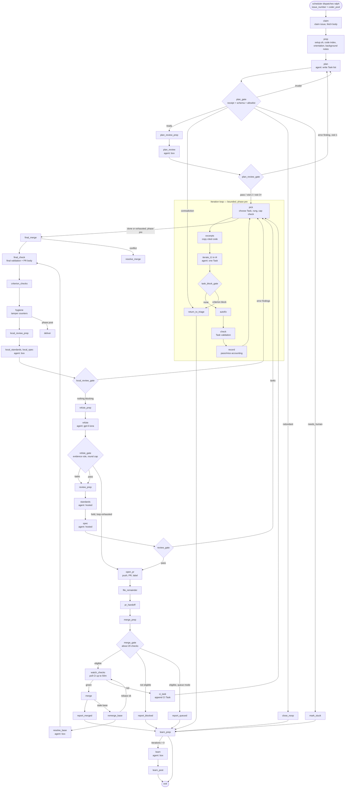
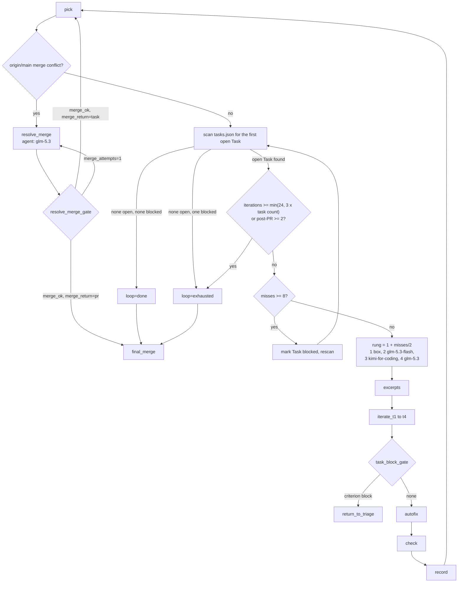
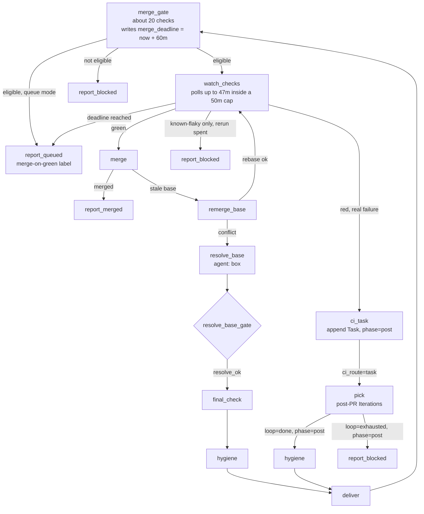

# Ralph: what the workflow actually does, stage by stage

This is a reader's guide to `.fabro/workflows/ralph/` — the package the scheduler
dispatches for an `agent`-labelled issue. It explains what each stage does, how the loops
are bounded, which model runs where, and how long each stage takes in practice.

It is documentation, not a contract. The source of truth is, in this order:

1. `.fabro/workflows/ralph/workflow.fabro` (the DOT graph, 59 nodes and 155 edges).
2. `.fabro/workflows/ralph/workflow.toml` (inputs, hooks, model fallbacks, environment).
3. `docs/agents/invariants-ralph.md` (the rules that pass `fabro validate` and fail at runtime).
4. `docs/ralph/00-overview-and-contracts.md` (the design decisions, O1–O25).

**Provenance.** Graph read at commit `b001346` (2026-11-21). Timing and outcome figures were
computed on 2026-11-21 from the scheduler's store (`/data/scheduler.db`, tables
`run_history`, `run_stage_stats`, `run_model_usage`, `run_summary`) on the fabro host, covering
373 `ralph` runs dispatched 2026-10-22T23:26Z through 2026-11-21T16:16Z. The store records
each run's wall-clock milliseconds summed across its visits to a node; the per-visit figures
below divide that by the visit count. See *Measurement caveats* at the end before quoting any
number.

---

## 1. What this thing is

Ralph is a **coding loop that ships a pull request for one issue and merges it itself**. It is
not a chat agent and it has no human gate: nothing in the graph waits for a person. A run
either merges its PR, hands the PR off with a label, or stops with a reason on the issue.

The shape is deliberately unusual, and the whole design rests on one idea: **the plan is
data, and every coding step is a fresh session that sees one Task from that plan and nothing
else of the planner's reasoning.** The planner writes a Task list to a file; command nodes
own that file; each Iteration reads one Task and writes code; a gate decides whether the Task
passed. No agent is ever asked "what should I do next" — the graph decides, from files that
command nodes wrote.

Two things follow, and both matter to a reader:

- **A Task list is a budget.** The planner writes at most 8 Tasks to `tasks.json`; the rest go
  to `remainder.json` and are filed as a separate issue after the PR opens. That is what keeps
  one run's PR reviewable.
- **Every stage is a file contract.** An agent writes JSON to a path under `/tmp/fabro/`, and a
  shell node validates it (`jq`), checks the Input receipt (`_io.stage`, `_io.visit`), and emits
  the context keys that pick the next edge. If you are debugging a run, the question is almost
  never "why did the model do that" but "which gate wrote which key".

### Who fires it

The coder scheduler dispatches `ralph` for issues that are not `fast-path`. Since
2026-11-02T19:13Z `SCHEDULER_RALPH_SHARE=100`, so every such issue runs `ralph`; `fast-path`
issues still run `backlog`. The scheduler leases a **coder pool** (a slot on one of the two
strix boxes) and passes it as `coder_pool`; the run claims that box before every agent stage
through the `box-claim` hook. Ralph never picks its own issue: the issue number is an input.
A hand-fired run goes through `~/bin/fabro-fire-ralph.sh <owner/repo> <issue>`.

### Vocabulary used below

| Term | Meaning in this graph |
|---|---|
| **Task** | One unit of work: `id`, `title`, `acceptance` list, `files` hint, `context` (an edit plan), `status`, `misses`. Stored in `/tmp/fabro/tasks.json`. |
| **Task list** | The array of Tasks the planner wrote. Only command nodes write it. |
| **Iteration** | One fresh coder session that takes the first `open` Task and tries to pass Task validation. `iterate_t1`–`iterate_t4` are the same prompt on four model rungs. |
| **Rung** | The model tier an Iteration runs on, derived from the Task's `misses`: 0–1 → rung 1 (box), 2–3 → rung 2 (`glm-5.3-flash`), 4–5 → rung 3 (`kimi-for-coding`), 6–7 → rung 4 (`glm-5.3`). At 8 misses the Task is marked `blocked` and the loop moves on. |
| **Refute round** | One visit by the Refuter agent, which is told the work is *not* done and must prove it with evidence. Capped at 3 visits. |
| **Phase** | `pre` (before the PR exists) or `post` (after `open_pr`). The `phase` file changes what `pick` and `final_check` do. |
| **Remainder** | Tasks 9+ from the planner, filed as a follow-up issue instead of being implemented. |
| **Learning** | A run-end entry with a rule, its evidence (`path:N` or a backticked command) and a proposed home, posted to a rolling issue. |

---

## 2. The map

The real graph is larger than this: every stage also has failure edges into `stop_reason`,
and `stop_reason` decides between `mark_stuck` (no PR) and `mark_needs_human` (PR exists).
`merge_gate`, `watch_checks`, `merge`, `remerge_base` and `resolve_base` are byte-for-byte or
near copies of the shared `_shared/review-merge/` nodes; `ops/check-graph-invariants.py` R10
fails the build if a copy drifts from the shared node.

---

## 3. Stage by stage

Times below are **median / p90 minutes per visit** in the current graph era (runs dispatched
since 2026-11-12, when the plan review and the local review replaced the old pre-review). The
"cap" column is the node's `timeout` attribute.

### Phase A — claim and prep (no model)

| Stage | What it does | Cap | Median / p90 |
|---|---|---|---|
| `claim` | Validates `issue_number`, writes it to `/tmp/fabro/issue_number` before any network call, swaps the label to `agent-in-progress` if the scheduler has not already, fetches the issue body. Fails closed on a closed or missing issue. Writes the run's box name to `/tmp/fabro/box` and the newest background notes (precheck verdict, context pack) to `background.md`. | — | 0.1 / 0.1 |
| `prep` | Runs the repository's `.fabro/setup.sh`, builds the code index (`fabro-code index`, `map`), reads the pinned `fabro-orientation` issue into `orientation.md` (capped 6,000 chars), installs the agent guide as `.codex/instructions.md`, and extracts the issue's `## Task map` section. | 20m | 2.2 / 3.2 |

Everything after this is file-backed: a stage that fails here ends the run at `stop_reason`
with the issue number already recorded, so `mark_stuck` can still comment on it.

### Phase B — plan and the plan review (the enforcing loop)

This is the part most worth understanding, because it is a bounded **loop**, not a single
pass. `plan` runs an agent that reads the whole issue and the checkout and writes
`task_list.json` through the `submit` tool. `plan_gate` validates it:

- the Input receipt must match this visit (`_io.stage`, `_io.visit` vs `.io/stage.json`);
- the schema must validate, and `task_list.json` must have a `disposition` of `ready`,
  `contradiction`, `redundant`, `invalid` or `needs_human`;
- on `ready` it writes the first 8 Tasks to `tasks.json`, the rest to `remainder.json`,
  filters `criterion_checks.json` through an allowlist (no shell metacharacters, a known
  runner, no deploy/publish/push/install, at most four commands);
- on `invalid` it retries once (`plan_attempts` < 2), then falls through.

`plan_gate -> plan_review_prep -> plan_review -> plan_review_gate` is the review cycle:

| Visit | `plan_review_gate` does |
|---|---|
| 1 | Counts `error` findings itself. Any error routes `repair`: it writes `plan_review/findings.md`, copies the planner's `task_list.json` to `previous_task_list.json`, deletes `task_list.json`, and routes back to `plan` for exactly one repair turn. |
| 2 | Re-reviews and routes `pass` **whatever it finds** (no second repair turn). |
| 3+ | Routes `go=false` straight to `pick`, without a review visit. |

The gate **fails closed**: a missing result, a result whose `_io.stage` is not `plan_review`,
a visit mismatch, or a `decision` outside `pass`/`repair` writes `stuck_reason.md` and exits 1
into `stop_reason`. That is the opposite of the local review in Phase D, which may only help.

If the repair turn writes no valid Task list, `plan_gate` treats `invalid` as `ready` when
`previous_task_list.json` exists and keeps the first plan, so a failed repair cannot close an
issue that did have actionable work.

| Stage | Model | Cap | Median / p90 |
|---|---|---|---|
| `plan` | `kimi-k3` (hosted) unless `(issue_number // 2) % 2 == 1`, in which case **the run's own box** (`qwen3.8-flash-next`) runs it — the box-plan trial, about half the runs | 80m | 9.4 / 28.3 overall; box arm 12.5 / 40.0, hosted arm 8.7 / 13.2 |
| `plan_review` | the run's leased box, `reasoning_effort: medium` | 40m | 9.5 / 28.0 |
| `plan_gate`, `plan_review_prep`, `plan_review_gate` | shell | 1m / 2m / 1m | < 0.1 |

Observed over 130 runs with the plan review: 100 runs reviewed once, 30 needed the repair
cycle, none reached visit 3. 12 `plan_review` visits hit their timeout.

### Phase C — the Iteration loop

`pick` is the single node that decides "what happens next". Its script, in order:

1. Deletes every per-Iteration file, including the `base-tree` worktree, so a stale
   `check_ok` cannot pass a Task whose validation never ran.
2. In `phase=pre` only, merges `origin/main`. A conflict aborts the merge and publishes
   `rebase_failed`, which routes to `resolve_merge` (a merge must never cross a stage
   boundary, because the checkpoint would commit conflict markers).
3. Takes the first Task with `status=open`. None open and none blocked → `done`. Any blocked →
   `exhausted`.
4. **The Iteration cap**: `min(24, 3 × the Task list's length)` before the PR, and `2` after
   it. The list grows as the Refuter and reviewers append Tasks, which is why the cap is read
   here and not once per run.
5. The rung from the Task's `misses`, as in the vocabulary table. At 8 misses the Task becomes
   `blocked` and the scan restarts.
6. Writes `current_task.json`, `task-context.md` (the Task's `context`, plus `## Last attempt`
   from the previous visit's `rework.md`), `rung`, and `task_base_sha`.

`pick` is where the loop's bounds live, so it is worth drawing on its own:

The loop therefore stops on one of four things: every Task passed, a Task blocked after 8
misses, the Iteration cap, or a mainline conflict that needs `resolve_merge`. There is no
"keep going until it feels done".

Then `excerpts` copies the exact text of every `path:N-M` the dossier cites (capped 40 KB,
150 lines per range) into `task-code.md`, plus `fabro-code callers` output for up to 12 named
symbols, so the coder's first turns are edits rather than reads.

`iterate_t1`–`iterate_t4` run the same prompt on the four rungs. The Iteration:

- makes `inputs` its first call and reads `current_task.json`, `task-context.md`,
  `task-code.md`, `background.md`, `progress.md`;
- edits the working tree (the pipeline owns commits and branches);
- may submit `task_blocked` with `kind`, `criterion`, `reason` when the Task cannot be done in
  its files;
- submits one result through the `submit` tool.

`task_block_gate` reads the block from `iteration.json`'s optional `blocked` object. A
`criterion` block routes to `return_to_triage` (the acceptance criterion contradicts the
issue's own non-goals). Otherwise `autofix` runs the repository's `.fabro/fix.sh` (formatters,
`lint --fix`) and `check` runs **Task validation**: the repository's checks and the tests that
cover the Task's changed files, selected by `fabro-io task-plan` from the diff; anything
unfamiliar falls back to the full suite. `check` writes `1` to `/tmp/fabro/check_ok` only on
the green path, and `record` decides `passed` from `check_ok`, the receipt, the submitted
`status`, and the absence of a block scope. `record` always succeeds; a bad Iteration is a
**miss**, never a stop — that is what the rung ladder is for.

| Stage | Model | Cap | Median / p90 per visit | Visits (143 runs) |
|---|---|---|---|---|
| `excerpts` | shell | 5m | 0.0 / 0.1 | 617 |
| `iterate_t1` | the run's box (`coders-a`…`coders-d`, `qwen3.8-flash-next` on strix-infer), `reasoning_effort: medium` | 120m | **19.8 / 39.6** | 617 |
| `iterate_t2` | `glm-5.3-flash` (z.ai) | 60m | — | 0 in this era |
| `iterate_t3` | `kimi-for-coding` | 60m | — | 0 in this era |
| `iterate_t4` | `glm-5.3` (z.ai) | 60m | — | 0 ever |
| `autofix` | shell | 15m | 1.0 / 1.4 | 607 |
| `check` | shell | 20m | 1.7 / 4.1 | 607 |
| `record`, `task_block_gate`, `pick` | shell | 1m / 1m / 5m | < 0.1 | 608 / 615 / 902 |

**How many Iterations actually run.** The cap is `min(24, 3 × Tasks)`, so with the planner's
8-Task budget it is 24; it drops as the list shrinks. In practice:

| Measure | Since 2026-11-12 (143 runs) | All 373 runs |
|---|---|---|
| Iterations per run, median | 4 | 4 |
| mean | 5.0 | 5.0 |
| p90 | 8 | 9 |
| maximum observed | 16 | 17 |
| post-PR Iterations (CI fixes) | cap 2 | `ci_task` visited at most 3 times in one run |

**The ladder is almost never climbed.** Rung 2 ran on 12 runs (all before 2026-11-12), rung 3
on 2 runs, rung 4 on none. The 8-miss `blocked` path, not the ladder, is what ends most
troublesome Tasks. This matters for cost: nearly every Iteration is on the free local box.

### Phase D — the gates before the PR

When every Task is passed (`loop=done`) or the cap is spent (`loop=exhausted`), `pick` routes
to `final_merge` in `phase=pre`. From there:

| Stage | What it does | Model | Cap | Median / p90 |
|---|---|---|---|---|
| `final_merge` | Merges `origin/main`; a conflict routes to `resolve_merge`. | shell | 5m | 0.0 |
| `resolve_merge` | Agent resolves the conflict, then `resolve_merge_gate` verifies no `MERGE_HEAD`, a clean tree, and a receipt; one retry allowed. | `glm-5.3` (class `coder-t4`) | 30m | 6.7 / 8.3 (5 visits) |
| `final_check` | Runs the full net: `.fabro/setup.sh` and `.fabro/ci.sh` on the whole tree, writes `validated_tree`, builds the PR body, records `base_ref=main`. Routes `pr`, `fix`, `stuck` or `needs_human`. | shell | 20m | 4.5 / 9.3 |
| `criterion_checks` | Runs only the commands `plan_gate` allowlisted, on the validated tree, and reverts any check that changes the checkout. Always exits 0. Skipped during the extra review pass, on a dirty tree, or without `timeout`. | shell | 30m | 0.0 |
| `hygiene` | Counts test tampering (deleted tests, added skips, removed or tautological assertions) and code erosion over the PR's added lines; any tamper counter blocks. | shell | 5m | 0.0 |
| `local_review_prep`, `local_review_gate` | Prepare the box review inputs (diff, stat, commits, 2 MB ceiling); the gate turns each `error` finding into a Task (`lrs<N>`/`lrp<N>`, `source: local_review`). | shell | 5m / 1m | 0.0 |
| `local_standards` | The hosted standards rubric, unchanged prompt, on the box. | box, medium | 60m | 9.8 / 27.2 |
| `local_spec` | The hosted spec rubric, unchanged prompt, on the box. | box, medium | 40m | 5.2 / 16.8 |
| `refute_prep` | Builds the Refuter's inputs: issue (minus `## Post-deploy checks`), the diff capped at 300 KB, the validation statement for this exact tree, the previous round's dropped findings, and a delta against the last Refute round's tree. Increments `refute_visits`. Skips the Refuter entirely while `review_extra=pending`. | shell | 5m | 0.0 |
| `refute` | The adversarial reviewer. Read-only; must give `path:N` or a backticked command for every `not_met` criterion and an existing `file` for every defect. | `gpt-6-luna` (OpenAI), fallback `qwen3.8-27b` | 15m | 1.0 / 1.7 |
| `refute_gate` | Applies the **evidence rule** first — findings without evidence are dropped into `refute_dropped.json` — then computes `pass`/`fail`. A failing round becomes Tasks (`r<round>c<N>`, `r<round>d<N>`) while `refute_visits < 3`. Writes `review/refute_verdict`, which `merge_gate` reads. When the loop is exhausted it routes `hold` whatever the verdict, and writes `fix_result.json` with `outcome: needs_human`. | shell | 1m | 0.0 |
| `review_prep` | Prepares the standards/spec inputs; clears all three review contracts first so a stale file is never read as this round's. | shell | 2m | 0.0 |
| `standards` | Documented standards rubric against the branch. | `kimi-k3`, fallbacks `glm-5.3-flash` → `glm-5.3` → `qwen3.8-27b` | 30m | 7.1 / 10.4 |
| `spec` | Judges the issue's acceptance criteria against the diff. | `kimi-k3`, same chain | 20m | 3.1 / 5.5 |
| `review_gate` | Blocks only on severity `error`; `warning` and `info` are reported. On `tasks` it appends Tasks (`rv<round>s<N>`/`p<N>`); on `pass` it writes `fix_result.json` in the shape `merge_gate` checks 7–10 expect. One **extra review pass** is allowed when the third Refute round is spent and a blocking finding remains: `review_extra=pending`, only the blocking axes re-run, no Refuter, and the next visit routes `pass` regardless. | shell | 1m | 0.0 |
| `open_pr` | Pushes the branch, opens the PR with the rendered body, adds `agent-authored`, and writes `pr_number`. Refuses to open a PR that already exists for the branch. | shell | — | 0.2 |
| `file_remainder` | Files Tasks 9+ as one follow-up issue and links it. | shell | — | 0.0 |
| `pr_handoff` | Hands the PR to the merge stage: writes `review_merge_outcome`, resolves the per-repo auto-merge switch. | shell | — | 0.0 |

**How many Refute rounds actually run.** The cap is 3 visits plus one extra review pass:

| Refute rounds in a run | Runs (the 315 that reached a Refuter) |
|---|---|
| 1 | 183 |
| 2 | 74 |
| 3 | 58 |

Reviews run in **every** round, right after the Refuter — `refute_gate -> review_prep` on
`tasks`, `pass` and a non-exhausted `hold`. They never run beside the Refuter, because two
agent stages at once would share `.io/stage.json`.

### Phase E — the merge stage

`merge_gate` is a long shell chain. It fails the merge on any of: auto-merge switched off,
missing `agent-authored`, `do-not-merge`, PR not open or still a draft, `CHANGES_REQUESTED`,
unresolved review threads, a commit not authored by the automation, `fix_result.outcome` not
`fixed`/`no_changes_needed`, `risk` above 3, unfixed findings, an error finding the report does
not account for, a non-Conventional-Commit title, a missing `fabro:commit-body` block with
`Resolves #`, a blocking `hygiene.json`, a tree that changed after `hygiene` ran, or
`refute_verdict != pass`. It then writes a 60-minute `merge_deadline`.

| Stage | What it does | Model | Cap | Median / p90 |
|---|---|---|---|---|
| `merge_prep` | Copy of the shared `rm_setup`; resolves the host-wide auto-merge switch into `auto_merge`. Missing file → every PR is blocked. | shell | 5m | 0.0 |
| `deliver` | Copy of the shared `deliver`; pushes and labels a PR that went through the `post` path (rebase/CI fix). | shell | — | 0.1 |
| `merge_gate` | As above. `merge_mode=queue` routes straight to `report_queued`. | shell | — | 0.1 |
| `watch_checks` | Polls GitHub checks (no flat sleep), one plain rerun of failed jobs per merge phase, then a FlakeRadar classification: a red that fails only on known-flaky tests gets one more rerun and then a hold; a real red becomes a CI Task. Two deadline stops publish `checks_deadline` instead of `blocked`, so a PR that passed every gate but ran out of time reaches `report_queued`. | shell | 50m | 14.4 / 28.2 |
| `merge` | Squash-merges on green. `stale` routes to `remerge_base`. | shell | 50m | 0.1 |
| `remerge_base` | Re-merges the base tip through the GitHub API; a conflict routes to `resolve_base`. | shell | — | never exercised |
| `resolve_base` | Agent resolves the base merge. | box, medium (class `merge-resolve`) | 60m | never exercised in the sample |
| `resolve_base_gate` | Verifies the base merge, then routes back to `final_check` for a fresh validation. | shell | 5m | never exercised |
| `ci_task` | Appends a CI Task (`ci<N>`) with the failing-check log, sets `phase=post`, routes to `pick`. At two post-PR Iterations it writes both reason files and routes `stop` → `report_blocked`. | shell | 2m | 0.0 |
| `report_merged`, `report_blocked`, `report_queued` | Render and post the review comment, write `/tmp/fabro/ending`, and fire the Discord hook. | shell | — | 0.1 / 0.0 |

The CI-fix and rebase paths are loops of their own. They are bounded by the merge deadline
and by the two post-PR Iterations, not by a fixed count of stages:

`ci_task` appends one Task per visit and routes to `pick` in `phase=post`. At two post-PR
Iterations it writes both reason files and routes `stop` → `report_blocked`, so a PR whose CI
will not go green never loops forever; it becomes the operator's problem with a reason.

### Phase F — endings and Learnings

Every terminal node reaches `exit` only through `learn_prep` (and `learn_post`), and each
writes its own id to `/tmp/fabro/ending`. `learn_prep` decides `skip` when the run had no
Iterations. `learn` proposes 0–5 Learnings on the box (cap 15m, no retry); `learn_post` drops
any entry whose `evidence` names no `path:N` and no backticked command, never fails the run,
and posts to the rolling `fabro:ralph-learnings` issue (labelled `learning`, never `agent`).

Terminal nodes: `mark_stuck` (no PR), `mark_needs_human` (PR exists, needs a person),
`close_noop` (the plan found nothing actionable), `return_to_triage` (a Contradiction),
`report_merged`, `report_blocked`, `report_queued`, plus `exit` after `learn_post`.

---

## 4. Models, by stage

The stylesheet is the authority; this table reproduces it with the fallback chains from
`workflow.toml`.

| Stage | Class | Model | Where it runs | Effort | Fallbacks |
|---|---|---|---|---|---|
| `plan` (hosted arm) | `.plan` | `kimi-k3` | hosted (Venice/Kimi) | — | `zai:glm-5.3-flash`, `zai:glm-5.3`, `orfallback:qwen3.8-27b` |
| `plan` (box arm) | `.plan` | the run's box (`coders-a`…`coders-d`) | local strix box, `qwen3.8-flash-next` | medium | `zai:glm-5.3-flash`, `openai:gpt-6-luna` |
| `plan_review` | `.plan-review` | the run's box | local box | medium | same as above |
| `iterate_t1` | `.coder` | the run's box | local box | medium | same as above |
| `iterate_t2` | `.coder-t2` | `glm-5.3-flash` | z.ai | — | `zai:glm-5.3` |
| `iterate_t3` | `.coder-t3` | `kimi-for-coding` | Kimi | — | `zai:glm-5.3` |
| `iterate_t4` | `.coder-t4` | `glm-5.3` | z.ai | — | `orfallback:qwen3.8-27b` (deliberately no Kimi rung) |
| `resolve_merge` | `coder-t4` | `glm-5.3` | z.ai | — | `orfallback:qwen3.8-27b` |
| `resolve_base` | `.merge-resolve` | the run's box | local box | medium | box chain |
| `local_standards`, `local_spec` | `.review-local` | the run's box | local box | medium | box chain |
| `refute` | `.refute` | `gpt-6-luna` | OpenAI | — | `orfallback:qwen3.8-27b` |
| `standards`, `spec` | `.review-standards` / `.review-spec` | `kimi-k3` | hosted | — | `zai:glm-5.3-flash`, `zai:glm-5.3`, `orfallback:qwen3.8-27b` |
| `learn` | `.learn` | the run's box | local box | medium | box chain |
| everything else | shell nodes | — | — | — | — |

Notes a reader will want:

- **`coder_pool` is never bound in `[run.inputs]`.** The stylesheet uses
  `{{ inputs.coder_pool | default('coders-a') }}`, and the scheduler passes the pool per run.
  Binding it would pin every hand-fired run to one slot.
- **The Refuter is deliberately cross-family.** Its fallback is a Qwen model on OpenRouter,
  never GLM and never OpenAI, so an OpenAI outage still leaves an independent Refuter.
- **`glm-4.7` may never appear** in any class: it is the one catalog model with
  `features.reasoning: false`, and replaying its reasoning blocks kills the stage.
- **What actually served the requests.** Since 2026-11-12 the store records 801 agent stages
  served by `zai/glm-5.3-flash` against 46 by `kimi/kimi-k3`. Kimi's weekly quota runs out
  mid-week, so the "hosted frontier" stages (`plan` hosted arm, `standards`, `spec`) spend most
  of their time on the first z.ai fallback. The box stages account for the rest
  (`coders-a`…`coders-d`, 860 stages), and `gpt-6-luna` for 200 Refuter stages.
- **The plan arm is real.** 154 of the 311 runs dispatched since 2026-10-28 planned on the
  run's own box rather than on the hosted chain (`(issue_number // 2) % 2 == 1`).

---

## 5. How long it takes

### Per stage, measured

Medians and p90s per visit, current graph era (143 runs, 2026-11-12 → 2026-11-21):

| Stage | Visits | p50 min | p90 min | Max | Timeouts |
|---|---|---|---|---|---|
| `plan` | 175 | 9.4 | 28.3 | 117.2 | 5 |
| `plan_review` | 160 | 9.5 | 28.0 | 80.0 | 12 |
| `iterate_t1` | 617 | 19.8 | 39.6 | 70.1 | 8 |
| `autofix` | 607 | 1.0 | 1.4 | 1.7 | 0 |
| `check` | 607 | 1.7 | 4.1 | 9.1 | 0 |
| `final_check` | 249 | 4.5 | 9.3 | 11.9 | 0 |
| `local_standards` | 117 | 9.8 | 27.2 | 79.1 | 7 |
| `local_spec` | 117 | 5.2 | 16.8 | 44.7 | 1 |
| `refute` | 200 | 1.0 | 1.7 | 2.9 | 0 |
| `standards` | 202 | 7.1 | 10.4 | 17.5 | 0 |
| `spec` | 200 | 3.1 | 5.5 | 8.6 | 0 |
| `watch_checks` | 114 | 14.4 | 28.2 | 47.3 | 0 |
| `learn` | 121 | 3.5 | 10.2 | 20.0 | 3 |
| `prep` | 143 | 2.2 | 3.2 | 4.0 | 0 |
| `claim`, `excerpts`, `hygiene`, `criterion_checks`, `merge_gate`, `merge`, `open_pr`, `ci_task` | — | ≤ 0.2 | ≤ 0.2 | ≤ 0.6 | 0 |

A max above the node's cap means a retry: `plan_review` hit 80 minutes on a 40-minute cap
(`max_retries=1`, so two attempts), and `plan` 117 minutes on its 80-minute cap.

### Where a run's time goes

Share of wall-clock time across the 75 merged runs of the current era:

| Stage | Share | Total minutes |
|---|---|---|
| Iterations (`iterate_t1`) | 46.5% | 7,675 |
| `watch_checks` (waiting on CI) | 10.2% | 1,690 |
| `plan` | 6.9% | 1,140 |
| `local_standards` | 6.0% | 983 |
| `plan_review` | 5.7% | 943 |
| `standards` | 5.2% | 864 |
| `check` | 4.0% | 659 |
| `final_check` | 4.0% | 658 |
| `local_spec` | 3.3% | 547 |
| `spec` | 2.2% | 367 |
| `learn` | 1.9% | 312 |
| `autofix` | 1.7% | 285 |
| `prep` | 1.1% | 181 |
| `refute` | 0.7% | 116 |

### Whole-run duration

| Population | Median | p90 |
|---|---|---|
| Merged runs, since 2026-11-12 (n=75) | 197 min | 390 min |
| Unmerged runs, all (n=152) | 166 min | — |
| All 373 runs | 137 min | 407 min |

The longest run in the sample took 2,465 minutes (41 hours) and is not a loop runaway: its
recorded stages add up to 148 minutes and its terminal node is `iterate_t1`, so it hung inside
an Iteration (the stage never completed, so nothing routed) rather than looping.

### One real run, minute by minute

Run `01M7ZE9KMX0KC2WXB0VCQEMYP9`, writers-app issue #1446, 2026-11-21, merged. 75 minutes
total; the numbers below are the stage durations fabro recorded.

| Time | Stage | Minutes |
|---|---|---|
| 16:16:15 | `claim` | 0.1 |
| 16:16:18 | `prep` | 2.0 |
| 16:18:18 | `plan` (box arm) | 5.6 |
| 16:23:54 | `plan_review` | 4.9 |
| 16:28:53 | `excerpts` | 0.1 |
| 16:28:53 | `iterate_t1` (the only Iteration) | 17.4 |
| 16:47:14 | `autofix` | 1.0 |
| 16:47:14 | `check` | 2.3 |
| 16:49:35 | `final_merge` + `final_check` | 3.7 |
| 17:00:29 | `local_standards` | 7.2 |
| 17:03:31 | `local_spec` | 3.0 |
| 17:03:55 | `refute` | 0.4 |
| 17:09:49 | `standards` | 5.9 |
| 17:11:02 | `spec` | 1.2 |
| 17:11:12 | `open_pr` → `pr_handoff` → `merge_prep` → `merge_gate` | 0.4 |
| 17:11:20 | `watch_checks` | 18.5 |
| 17:29:58 | `merge` → `report_merged` | 0.1 |
| 17:31:22 | `learn` | 1.3 |

That run is the best case shape: one Iteration, both review rounds clean, CI green on the
first settle. Most runs spend far longer in Phase C: the median merged run is 197 minutes,
because the median run works 4–5 Tasks and the median Iteration is ~20 minutes.

---

## 6. How runs end

All 373 runs, by terminal node:

| Terminal node | Runs | Share |
|---|---|---|
| `report_merged` | 148 | 39.7% |
| `report_blocked` | 133 | 35.7% |
| `mark_stuck` | 31 | 8.3% |
| `return_to_triage` | 24 | 6.4% |
| `report_queued` (`merge-on-green`, merge-queue takes over) | 17 | 4.6% |
| `close_noop` | 4 | 1.1% |
| `mark_needs_human` | 1 | 0.3% |
| early failures (`prep`, `plan`, `iterate_t1`, `plan_review`, `standards`) | 15 | 4.0% |

Current era (143 runs): 75 merged, 36 blocked, 9 returned to triage, 9 stuck, 2 queued,
1 needs-human, 11 stopped early.

The 2026-11-02 trial result (`docs/ralph/result-2026-11-02.txt`) put this against `backlog`:
0.35 against 0.22 merges per run, and −49% box-hours per merge, which is why
`SCHEDULER_RALPH_SHARE` went to 100.

---

## 7. The safety rails a reader should know about

These are the things that stop the loop from being an expensive toy. Each one is a row in
`docs/agents/invariants-ralph.md`; the graph passes `fabro validate` either way, so they are
worth knowing before you change anything.

- **No human gate anywhere.** A 4-hour gate would hold a coder box idle. Every stop that
  `backlog` sends to a human goes to `mark_stuck` (no PR) or a merge-stage report (PR exists).
- **The Task list is written only by command nodes** (`plan_gate`, `pick`, `record`,
  `refute_gate`, `review_gate`, `local_review_gate`, `final_check`, `ci_task`). The `io-guard`
  hook seals it from the Refuter and both reviewers, so nobody grades their own work.
- **The evidence rule.** `refute_gate` drops a `not_met` criterion with no `path:N` and no
  backticked command, and a defect with no existing file, before it computes a verdict. A
  dropped finding is silently a *pass* — which is why the prompt states the rule too.
- **The budget.** 8 Tasks implemented, the rest filed as a Remainder issue; `min(24, 3×Tasks)`
  Iterations; 3 Refute visits; one extra review pass; 2 post-PR Iterations.
- **Fail-closed where it matters, fail-open where it must not cost a run.** The plan review
  gate fails closed (an unreviewable Task list stops the run); the local review may only help
  (every fallback goes to `refute_prep`, never to `stop_reason`).
- **Auto-merge is a switch, not a constant.** `merge_gate` blocks every PR when
  `/tmp/fabro/auto_merge` is missing; the host-wide and per-repo switches are resolved in
  `merge_prep`.
- **Nothing reads a finished run's sandbox.** Every contract is a file under `/tmp/fabro/`
  copied into the checkpoint; the reason files (`merge_block_reason`, `needs_human_reason`,
  `stuck_reason.md`) are written by the node that knows why.

---

## 8. Measurement caveats

If you are going to quote these numbers, know what they are:

- `run_stage_stats.wall_ms` is **summed across a run's visits to a node**, not one visit. The
  per-visit figures above divide by the visit count, which is right for the median but not for
  a single stage in a specific run.
- A retry makes a stage's wall time exceed its `timeout` (two attempts on a node with
  `max_retries=1`). `plan_review`'s 80-minute maximum on a 40-minute cap is that, not a bug.
- The store only holds runs the scheduler dispatched and summarized. Hand-fired runs and runs
  the scheduler never recorded are absent, and the sample is biased toward recent graph
  versions; the graph changed materially on 2026-11-12 (`plan_review` and the local review
  replaced the old `pre_review`), which is why the tables split at that date.
- The `timeouts` column counts stage timeouts, not failed Iteration attempts. The attempt-level
  numbers (and the 13.8% writers-app failure rate) are in `docs/ralph/result-2026-11-08.txt`,
  recomputable with `ops/iterate-attempts.py`.
- `run_model_usage` attributes served models to a **run**, not a stage. The stage→model table
  is read from the stylesheet; the served-model counts are the run-level aggregate.
- Wall times include the `box-claim` hook's wait for the box to go idle (up to 60 s) before
  each agent stage, and the per-stage checkpoint commit.

---

## 9. Where to go next

| Question | File |
|---|---|
| What each rule prevents | `docs/agents/invariants-ralph.md` |
| Why the design is shaped this way (O1–O25) | `docs/ralph/00-overview-and-contracts.md`, `docs/adr/0029-ralph-workflow-trial.md` |
| The iteration loop's design | `docs/ralph/03-iteration-loop.md` |
| The Refute rounds and the evidence rule | `docs/ralph/04-refute-rounds.md` |
| The pre-PR review design (ralph now runs the local box round instead) | `docs/ralph/05-pre-pr-review.md` |
| The merge stage and its copies | `docs/ralph/07-merge-stage.md` |
| Learnings | `docs/ralph/08-learnings.md` |
| The scheduler's routing and the trial | `docs/ralph/09-scheduler-routing.md`, `docs/ralph/13-reviewing-the-arms.md` |
| Why Iterations time out | `docs/ralph/14-iteration-runaways.md` |
| The graph invariants every stage must satisfy | `docs/agents/invariants-graph.md` |
| What each validation gate covers and misses | `docs/agents/validating.md` |
